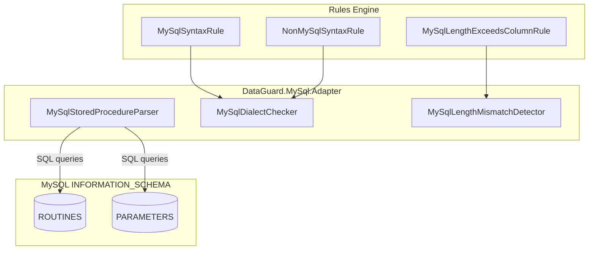

# Bộ Adapter MySQL

Bộ Adapter MySQL cung cấp xác thực contract giữa các entity .NET và stored procedure MySQL sử dụng thư viện MySqlConnector và các view `INFORMATION_SCHEMA`.

## Kiến trúc



## File nguồn

| File | Mục đích |
|------|----------|
| `MySqlStoredProcedureParser.cs` | Triển khai IContractSource cho MySQL SP |
| `MySqlDialectChecker.cs` | Phát hiện phương ngữ + rules MY001/MY002 |
| `MySqlLengthMismatchDetector.cs` | Phát hiện sai lệch độ dài + rules MY004–MY007 |

## Phụ thuộc

```xml
<PackageReference Include="MySqlConnector" Version="2.6.2" />
<ProjectReference Include="..\DataGuard.Core\DataGuard.Core.csproj" />
```

## MySqlStoredProcedureParser

Triển khai `IContractSource` để trích xuất contract procedure và function từ `INFORMATION_SCHEMA` của MySQL.

### Mẫu truy vấn

```sql
SELECT r.ROUTINE_NAME, p.PARAMETER_NAME, p.DATA_TYPE, p.PARAMETER_MODE,
       p.ORDINAL_POSITION, p.CHARACTER_MAXIMUM_LENGTH, p.NUMERIC_PRECISION,
       p.NUMERIC_SCALE, r.ROUTINE_SCHEMA, r.ROUTINE_TYPE, r.DATA_TYPE
FROM information_schema.ROUTINES r
LEFT JOIN information_schema.PARAMETERS p
  ON r.ROUTINE_SCHEMA = p.SPECIFIC_SCHEMA AND r.SPECIFIC_NAME = p.SPECIFIC_NAME
 AND p.ROUTINE_TYPE = r.ROUTINE_TYPE
WHERE r.ROUTINE_TYPE IN ('PROCEDURE', 'FUNCTION')
  AND ((@schema <> '' AND r.ROUTINE_SCHEMA = @schema)
    OR (@schema = '' AND r.ROUTINE_SCHEMA NOT IN
        ('mysql', 'sys', 'information_schema', 'performance_schema')))
ORDER BY r.ROUTINE_SCHEMA, r.ROUTINE_TYPE, r.ROUTINE_NAME, p.ORDINAL_POSITION
```

### Quyết định thiết kế chính

- **LEFT JOIN**: Procedure không có tham số xuất hiện dưới dạng một dòng với các trường tham số NULL. Parser vẫn tạo `StoredProcedureDescriptor` rỗng; chỉ bỏ qua việc tạo parameter cho dòng đó.
- **Lọc schema**: Khi không chỉ định schema, adapter dùng `SELECT DATABASE()`; nếu không chọn database thì đọc các schema ngoài hệ thống. Schema chỉ định được lọc chính xác.
- **Xử lý overload**: MySQL không hỗ trợ overload procedure, vì vậy mỗi tên procedure ánh xạ đúng một contract.
- **Chuẩn hóa độ dài**: `CHARACTER_MAXIMUM_LENGTH` trả về `BIGINT` — chuẩn hóa thành `int?` với bảo vệ tràn.

### Ánh xạ direction

| MySQL Mode | Direction DataGuard |
|------------|---------------------|
| `IN` | `Input` |
| `OUT` | `Output` |
| `INOUT` | `InputOutput` |

### Định dạng Contract ID

```
mysql:{schema}.{procedure_name}
mysql:{schema}.{function_name}#function
```

## MySqlDialectChecker

Phát hiện cú pháp đặc thù MySQL trong ngữ cảnh không phải MySQL và ngược lại sử dụng khớp từ khóa qua `SqlKeywordMatcher.ContainsAny()`.

### Từ khóa chỉ MySQL

| Từ khóa | Mục đích |
|---------|----------|
| `ON DUPLICATE KEY` | Cú pháp upsert MySQL |
| `REPLACE INTO` | Cú pháp replace MySQL |
| `` ` `` (backtick) | Trích dẫn định danh MySQL |
| `ENGINE=InnoDB` | Storage engine MySQL |
| `AUTO_INCREMENT` | Tự động tăng MySQL |

### Từ khóa không phải MySQL (phát hiện trong ngữ cảnh MySQL)

| Từ khóa | Nguồn gốc |
|---------|-----------|
| `NVL` | Oracle |
| `TOP ` | SQL Server |
| `ROWNUM` | Oracle |
| `GETDATE` | SQL Server |
| `FETCH FIRST` | Standard SQL / PostgreSQL |

## MySqlLengthMismatchDetector

So sánh `MaxLength` của entity với `CHARACTER_MAXIMUM_LENGTH` của cột MySQL. MY004 kiểm tra độ dài ký tự; các rule riêng kiểm tra giới hạn byte, ước tính kích thước hàng và rủi ro suy luận kích thước. Đoạn mã dưới đây chỉ minh họa so sánh độ dài ký tự.

### Logic phát hiện

```csharp
foreach (var property in entity.Properties)
{
    var column = columns.FirstOrDefault(c =>
        string.Equals(c.Name, property.ColumnName, StringComparison.OrdinalIgnoreCase));
    if (column == null || !property.MaxLength.HasValue || !column.MaxLength.HasValue)
        continue;

    if (property.MaxLength.Value > column.MaxLength.Value)
        yield return new ContractViolation("MY004", ...);
}
```

## Tham chiếu Rules

### MY001 — Cú pháp MySQL trong ngữ cảnh không phải MySQL

| Thuộc tính | Giá trị |
|------------|---------|
| **Mức độ** | Warning |
| **Kích hoạt** | Từ khóa MySQL (`ON DUPLICATE KEY`, backticks, etc.) trong SQL không phải MySQL |
| **Thông báo** | MySQL-specific syntax '{syntax}' used in non-MySQL context |
| **Ngữ cảnh** | `ConnectionProviderHint` của descriptor, hoặc provider của catalog khi không có hint. Rule không làm gì khi ngữ cảnh là `mysql`, nên cú pháp của chính MySQL không bao giờ bị báo dưới `--provider mysql`. Khi không có cả provider lẫn hint, ngữ cảnh được coi là không phải MySQL. |

### MY002 — Cú pháp không phải MySQL trong ngữ cảnh MySQL

| Thuộc tính | Giá trị |
|------------|---------|
| **Mức độ** | Warning |
| **Kích hoạt** | Từ khóa Oracle/SQL Server (`NVL`, `TOP`, `GETDATE`, etc.) trong SQL MySQL |
| **Thông báo** | Non-MySQL syntax '{syntax}' used in MySQL context |

### MY004 — Độ dài entity vượt độ dài cột MySQL

| Thuộc tính | Giá trị |
|------------|---------|
| **Mức độ** | Error |
| **Kích hoạt** | `property.MaxLength > column.MaxLength` |
| **Thông báo** | Entity property '{name}' MaxLength={n} exceeds column '{col}' length={m} |

Rule MY003 riêng (`MySqlVarcharByteLimitRule`) cũng kiểm tra các cột họ TEXT. Giới hạn của chúng tính bằng byte, nên độ dài entity được quy đổi giống MY006: `MaxLength × số byte mỗi đơn vị UTF-16` (utf8mb4/utf8mb3/utf8 là 3, ucs2/utf16 là 2, bộ ký tự một byte là 1, `byte[]` là 1). Một `string` có `MaxLength = 30000` trên cột `TEXT` utf8mb4 (90.000 byte) sẽ bị báo: `may need 90000 bytes (3 per character in utf8mb4) but MySQL TEXT holds at most 65535 bytes`.

## Sử dụng trong CLI

```bash
# Xác thực contract MySQL
dataguard validate --provider mysql --connection "Server=localhost;Database=mydb;Uid=root;..."

# Với bộ lọc schema
dataguard validate --provider mysql --connection "..." --schema mydb
```

## Lưu ý đặc thù MySQL

### Không hỗ trợ package

Không giống Oracle, MySQL không có package. Trường `PackageName` luôn rỗng trong contract MySQL.

### Giới hạn INFORMATION_SCHEMA

Trường tham số NULL từ LEFT JOIN biểu diễn routine không có tham số; parser chỉ bỏ qua việc tạo parameter. Thiếu view catalog hoặc lỗi quyền truy cập không tương đương với contract rỗng hợp lệ.

### Nhận biết bộ ký tự

`CHARACTER_MAXIMUM_LENGTH` của MySQL luôn tính bằng ký tự (không phải byte), bất kể bộ ký tự của cột. Điều này đơn giản hóa so sánh độ dài so với ngữ nghĩa CHAR/BYTE của Oracle.

## Cập nhật catalog và length semantics (Phase 3.3/3.7)

- Đọc `ROUTINE_TYPE IN ('PROCEDURE','FUNCTION')`. Function có `ReturnType` và Id dạng `mysql:{schema}.{name}#function`.
- Schema để trống thì dùng `DATABASE()`, không còn gộp mọi schema. Khóa bảng tuân theo `@@lower_case_table_names`.
- Charset nằm ở `ColumnDescriptor.Charset`, còn `CharUsed` là null.
- MY006 so sánh theo byte: `MaxLength × byte/đơn vị UTF-16`, với utf8mb4 = 3.
- MY005 kiểm tra kích thước hàng (tổng byte VARCHAR/CHAR > 65.535). Index-prefix không được kiểm tra vì descriptor không có thông tin index.
- MY007 chỉ báo khi property không có `MaxLength` mà cột là `varchar(n)`/`char(n)`, vì Pomelo map `string` không giới hạn thành `longtext`.
- `utf8mb3` = 3 byte.


Catalog đọc cả procedure và function; hàng trả về có ordinal 0 của function trở thành `ReturnType`. Parser không đọc thân routine để suy ra result set: `ResultColumns` rỗng. `MySqlLiveQuerySchemaProvider` là path riêng để mô tả raw SQL được hỗ trợ; không chứng minh result shape của mọi routine.

Nguồn triển khai được đối chiếu: [MySqlStoredProcedureParser.cs](../../../src/DataGuard.MySql.Adapter/MySqlStoredProcedureParser.cs). Các giới hạn mô tả ở đây là hành vi hiện tại, không phải cam kết parity giữa provider hay bằng chứng kiểm thử cơ sở dữ liệu live.
