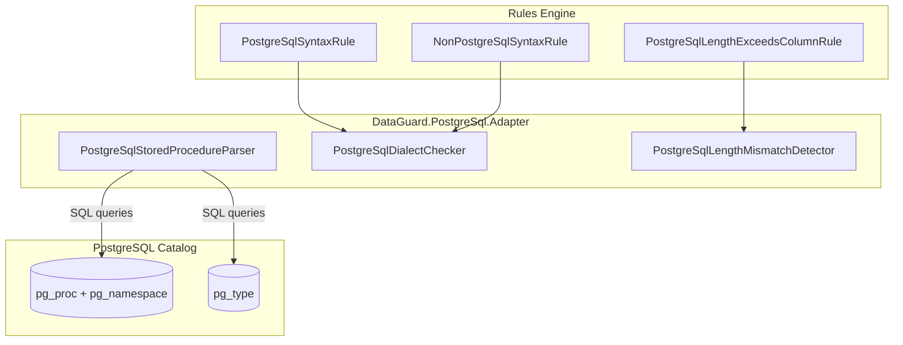

# Bộ Adapter PostgreSQL

Bộ Adapter PostgreSQL cung cấp xác thực contract giữa các entity .NET và stored procedure PostgreSQL sử dụng thư viện Npgsql và các view `information_schema` / `pg_catalog`.

## Kiến trúc



## File nguồn

| File | Mục đích |
|------|----------|
| `PostgreSqlStoredProcedureParser.cs` | Triển khai IContractSource cho PostgreSQL SP |
| `PostgreSqlDialectChecker.cs` | Phát hiện phương ngữ + rules PG001/PG002 |
| `PostgreSqlLengthMismatchDetector.cs` | Phát hiện sai lệch độ dài + rule PG003 |

## Phụ thuộc

```xml
<PackageReference Include="Npgsql" Version="10.0.3" />
<ProjectReference Include="..\DataGuard.Core\DataGuard.Core.csproj" />
```

## PostgreSqlStoredProcedureParser

Triển khai `IContractSource`, đọc function và procedure từ `pg_proc` + `pg_type`, cùng bảng, view và materialized view cho các rule độ dài.

### Mẫu truy vấn

```sql
SELECT p.proname, n.nspname, p.proargnames, p.proargtypes, p.proallargtypes, p.proargmodes,
       p.prorettype, p.oid, p.prokind, p.pronargs, p.pronargdefaults, p.proretset
FROM pg_proc p JOIN pg_namespace n ON n.oid = p.pronamespace
WHERE n.nspname = @schema AND p.prokind IN ('f', 'p')
```

Cột bảng lấy từ `information_schema.columns`; cột materialized view lấy từ `pg_matviews` và `pg_attribute`. Khóa bảng giữ nguyên tên catalog, so sánh ordinal; `DatabaseTableDescriptor.Schema` được gán.

### Quyết định thiết kế chính

- **Schema mặc định**: `"public"`.
- **RETURNS TABLE**: đối số `proargmodes = 't'` trở thành `ResultColumns` (tên, `typname`), không phải parameter.
- **Giá trị mặc định**: `pronargdefaults = N` đặt `HasDefault` cho N tham số input (`i`/`b`/`v`) cuối.
- **Đối số không tên**: tên rỗng trở thành `p{i}` (đánh số từ 1).
- **Kiểu trả về**: function có `ReturnType = typname(prorettype)`; `refcursor` đặt `ReturnsRefCursor`.
- **Package**: `PackageName` luôn rỗng.

### Ánh xạ direction

| `proargmodes` | StackAccord |
|---------------|-----------|
| `i` | `Input` |
| `o` | `Output` |
| `b` | `InputOutput` |
| `v` (VARIADIC) | `Input` |
| `t` (TABLE) | cột kết quả |

### Định dạng Contract ID

```
postgres:{schema}.{name}({in-arg type names})
```

Ví dụ `postgres:public.find_orders(int4,text)`. Chữ ký dùng `proargtypes` (IN, INOUT, VARIADIC) để phân biệt overload; khác OID, chữ ký ổn định qua dump/restore.

## PostgreSqlDialectChecker

Phát hiện cú pháp đặc thù PostgreSQL trong ngữ cảnh không phải PostgreSQL và ngược lại.

### Từ khóa chỉ PostgreSQL

| Từ khóa | Mục đích |
|---------|----------|
| `SERIAL` | Integer tự động tăng |
| `BIGSERIAL` | Bigint tự động tăng |
| `ILIKE` | LIKE không phân biệt hoa thường |
| `::` | Toán tử chuyển đổi kiểu |

### Từ khóa không phải PostgreSQL (phát hiện trong ngữ cảnh PostgreSQL)

| Từ khóa | Nguồn gốc |
|---------|-----------|
| `NVL` | Oracle |
| `TOP ` | SQL Server |
| `ROWNUM` | Oracle |
| `GETDATE` | SQL Server |
| `CONVERT(` | SQL Server |
| `DATEPART` | SQL Server |

## PostgreSqlLengthMismatchDetector

So sánh `MaxLength` của entity với `character_maximum_length` của cột PostgreSQL. So sánh trực tiếp — PostgreSQL lưu độ dài ký tự (không phải byte) trong `information_schema`.

### Logic phát hiện

```csharp
foreach (var property in entity.Properties)
{
    var column = columns.FirstOrDefault(c =>
        string.Equals(c.Name, property.ColumnName, StringComparison.OrdinalIgnoreCase));
    if (column == null || !property.MaxLength.HasValue || !column.MaxLength.HasValue)
        continue;

    if (property.MaxLength.Value > column.MaxLength.Value)
        yield return new ContractViolation("PG003", ...);
}
```

## Tham chiếu Rules

### PG001 — Cú pháp PostgreSQL trong ngữ cảnh không phải PostgreSQL

| Thuộc tính | Giá trị |
|------------|---------|
| **Mức độ** | Warning |
| **Kích hoạt** | Từ khóa PostgreSQL (`SERIAL`, `ILIKE`, `::`, etc.) trong SQL không phải PostgreSQL |
| **Thông báo** | PostgreSQL-specific syntax '{syntax}' used in non-PostgreSQL context |
| **Ngữ cảnh** | `ConnectionProviderHint` của descriptor, hoặc provider của catalog khi không có hint. Rule không làm gì khi ngữ cảnh là `postgresql`, nên cú pháp của chính PostgreSQL không bao giờ bị báo dưới `--provider postgresql`. Khi không có cả provider lẫn hint, ngữ cảnh được coi là không phải PostgreSQL. |

### PG002 — Cú pháp không phải PostgreSQL trong ngữ cảnh PostgreSQL

| Thuộc tính | Giá trị |
|------------|---------|
| **Mức độ** | Warning |
| **Kích hoạt** | Từ khóa Oracle/SQL Server (`NVL`, `TOP`, `GETDATE`, `CONVERT`, etc.) trong SQL PostgreSQL |
| **Thông báo** | Non-PostgreSQL syntax '{syntax}' used in PostgreSQL context |

Mỗi cấu trúc chỉ bị báo một lần. Các mẫu chuyên biệt (`TOP n`, `EXEC schema.proc`, `LIMIT offset, count`, `NVL(`, `DECODE(`, `ISNULL(`, `GETDATE()`, `IDENTITY(`) chạy trước và có `suggestion`; từ khóa đã được chúng báo thì danh sách từ khóa bỏ qua. Cú pháp của chính PostgreSQL không bị báo: `LIMIT n` thông thường, `GENERATED ... AS IDENTITY`, và `COALESCE` (ANSI SQL, không dialect checker nào coi là đặc thù Oracle).

### PG003 — Độ dài entity vượt độ dài cột PostgreSQL

| Thuộc tính | Giá trị |
|------------|---------|
| **Mức độ** | Error |
| **Kích hoạt** | `property.MaxLength > column.MaxLength` |
| **Thông báo** | Entity property '{name}' MaxLength={n} exceeds column '{col}' length={m} |

## Sử dụng trong CLI

```bash
# Xác thực contract PostgreSQL
dataguard validate --provider postgresql --connection "Host=localhost;Database=mydb;Username=postgres;..."

# Viết tắt
dataguard validate --provider postgres --connection "..." --schema public
```

Cả `postgresql` và `postgres` đều được chấp nhận làm tên provider.

## Lưu ý đặc thù PostgreSQL

### Function vs Procedure

PostgreSQL 11+ giới thiệu `PROCEDURE` như một đối tượng riêng biệt với `FUNCTION`. Parser đọc cả hai (`prokind IN ('f','p')`); function có `ReturnType`.

### Function overloaded

PostgreSQL cho phép nhiều function cùng tên nhưng khác kiểu tham số (overloading). Chữ ký kiểu tham số IN trong contract Id phân biệt các overload.

### Qualification schema

`information_schema` của PostgreSQL phân biệt hoa thường cho tên schema. Schema mặc định `"public"` là chữ thường, khớp quy ước PostgreSQL.

### Hệ thống kiểu

PostgreSQL có hệ thống kiểu phong phú bao gồm array, kiểu composite, và domain tùy chỉnh. Metadata routine dùng `pg_type.typname` tra theo OID kiểu từ catalog. Đây không phải xác thực ngữ nghĩa đầy đủ cho array, composite hay domain; ánh xạ kiểu chưa hỗ trợ vẫn là Unknown/unevaluated.

## Cập nhật catalog (Phase 3.3/3.7)

- Đối số `proargmodes 't'` (RETURNS TABLE) trở thành `ResultColumns`, không phải tham số. `'o'` là Output, `'b'` là InputOutput, `'v'` là Input. `pronargdefaults = N` đặt `HasDefault` cho N tham số input cuối. Tên rỗng trong `proargnames` trở thành `p{i}`.
- Id có dạng `postgres:{schema}.{name}({kiểu IN})`, ví dụ `postgres:public.find_orders(int4,text)`.
- Materialized view được đọc qua `pg_matviews`. Khóa bảng giữ đúng tên catalog (so sánh Ordinal), và `DatabaseTableDescriptor.Schema` được gán.
- PG003: mỗi property có tối đa một vi phạm. Không còn kiểm tra byte UTF-8, vì `varchar(n)` của PostgreSQL giới hạn theo ký tự. Tên cột được thử thêm dạng snake_case.


ResultColumns của routine chỉ được suy ra từ metadata RETURNS TABLE, không từ việc phân tích thân function; OUT vẫn là parameter. Nullability tham số được đặt true vì pg_proc không cung cấp thông tin này. Path live raw SQL riêng không làm cho mọi routine có result shape đã xác thực.

Nguồn triển khai được đối chiếu: [PostgreSqlStoredProcedureParser.cs](../../../src/DataGuard.PostgreSql.Adapter/PostgreSqlStoredProcedureParser.cs). Các giới hạn mô tả ở đây là hành vi hiện tại, không phải cam kết parity giữa provider hay bằng chứng kiểm thử cơ sở dữ liệu live.
