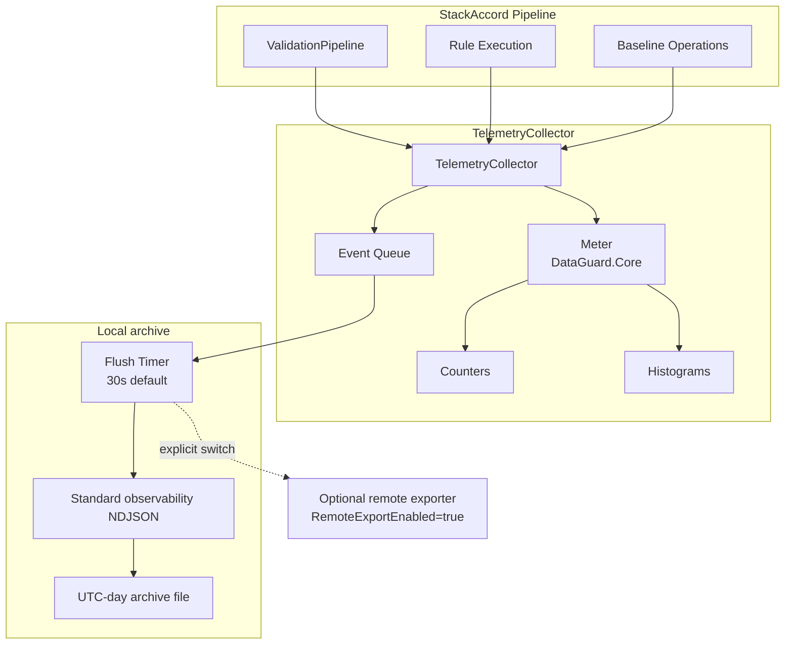

# Telemetry

> Source: `src/DataGuard.Core/Telemetry/TelemetryCollector.cs`

StackAccord's telemetry system is **opt-in, local-only** by default. It uses
`System.Diagnostics.Metrics` (the .NET 9 standard) and automatically writes a bounded,
allowlisted observability envelope to UTC-day NDJSON archive files when enabled. The legacy
NDJSON HTTP exporter is retained only as an explicit compatibility path; `RemoteExportEnabled`
defaults to `false` and no endpoint is contacted implicitly. See
[`docs/observability/local-file-observability.md`](../../observability/local-file-observability.md).

## Telemetry Flow



## TelemetryCollector

Central collector using `System.Diagnostics.Metrics`.

```csharp
public sealed class TelemetryCollector : IDisposable, IAsyncDisposable
{
    private readonly Meter _meter;
    private readonly TelemetryConfig _config;
    private readonly ConcurrentDictionary<string, Counter<long>> _counters = new();
    private readonly ConcurrentDictionary<string, Histogram<double>> _histograms = new();
    private readonly ConcurrentQueue<TelemetryEvent> _eventQueue = new();
    private readonly Timer? _flushTimer;

    public TelemetryCollector(TelemetryConfig config, Func<string, string, Task>? exportSink = null) { ... }
}
```

### Key Design Decisions

| Decision | Rationale |
|----------|-----------|
| **Opt-in only** | `TelemetryConfig.Enabled = false` by default |
| **Local archive first** | Events and metrics are written to daily NDJSON without network egress |
| **Standard .NET APIs** | Uses `System.Diagnostics.Metrics` for compatibility with OpenTelemetry |
| **Bounded/fail-open** | Queue, payload and record limits expose drops without failing validation |
| **Remote switch** | `RemoteExportEnabled=false` blocks the compatibility HTTP exporter |

`FlushAsync(CancellationToken)` is the additive asynchronous flush API. A single flush gate prevents overlapping exports; a failed or cancelled export returns its drained events to the queue for retry. `FlushEvents(object?)` remains for existing callers and waits for the same path. `TelemetryFlushResult` exposes no-work, in-progress, circuit-open, rejected-endpoint, failed/cancelled, and exported outcomes. Rejected endpoints intentionally drop queued events because no permitted destination exists.

The collector lifecycle is `Active → Stopping → Stopped`. `DisposeAsync()` transitions
through those states, stops timer-driven work, and makes one final bounded flush attempt;
new events are refused after `Stopping`. `TerminalLossCount` reports queued events
that remain undelivered when shutdown completes. The legacy synchronous `Dispose()` is
best effort. If a legacy export delegate does
not finish before its timeout, the collector retains its batch and holds the
single-flight gate until that delegate exits, so timer ticks cannot pile up more
exports.

## TelemetryConfig

```csharp
public sealed record TelemetryConfig(
    bool Enabled = false,
    string? ExportEndpoint = null,
    int FlushIntervalSeconds = 30,
    bool IncludeStackTraces = false);
```

| Field | Default | Description |
|-------|---------|-------------|
| `Enabled` | `false` | Recording/flush switch; disabled recording does not imply the object allocates no resources |
| `ExportEndpoint` | `null` | Compatibility URL: HTTPS, or HTTP loopback; native remote export requires `RemoteExportEnabled=true` and no active file sink |
| `FlushIntervalSeconds` | `30` | Timer interval for event flushing |
| `IncludeStackTraces` | `false` | Legacy constructor option; the collector does not currently use it to collect or strip stack traces |
| `MaxQueuedEvents` | `10,000` | Maximum queued plus in-flight events; newer events are dropped after the cap |
| `MaxBatchEvents` | `1,000` | Maximum events in one export request |
| `MaxPayloadBytes` | `1,048,576` | UTF-8 byte ceiling for one request; an individually oversized event is dropped |
| `ExportTimeoutSeconds` | `5` | Bounded wait for one export delegate |
| `FileSinkEnabled` | `true` | Primary local archive when no exporter delegate is injected |
| `FileSinkDirectory` | OS local app-data | Root of `yyyy/MM/dd/` archive directories |
| `FileSinkFilePrefix` | `observability` | Daily file prefix |
| `ServiceName` / `ServiceVersion` / `EnvironmentName` | `dataguard` / `unknown` / `local` | Bounded resource metadata |
| `RemoteExportEnabled` | `false` | Explicit owner-gated legacy network switch |
| `IncludeEventDetails` | `false` | Optional redacted/capped event body; no body by default |
| `MaxRecordBytes` | `65,536` | Maximum serialized local record size |

The bounds are additive init properties, so the primary constructor and its
existing deconstruction shape remain unchanged. `DroppedEventCount` exposes losses
from queue, payload, and rejected-endpoint limits.

## Metrics

### Counters

| Counter | Tags | Description |
|---------|------|-------------|
| `rule.executions` | `rule`, `success` | Per-rule execution count |
| `validations.total` | — | Total validation runs |
| `violations.total` | — | Total violations found |
| `violations.errors` | — | Error-severity violations |
| `violations.warnings` | — | Warning-severity violations |

### Histograms

| Histogram | Unit | Tags | Description |
|-----------|------|------|-------------|
| `rule.duration` | ms | `rule`, `success` | Per-rule execution time |
| `validation.contracts` | — | — | Contracts per validation run |
| `validation.duration` | ms | — | Total validation time |

### Recording Methods

```csharp
// Counter increment
collector.IncrementCounter("rule.executions", 1, new[] {
    new KeyValuePair<string, object?>("rule", "DG002"),
    new KeyValuePair<string, object?>("success", "true"),
});

// Histogram value
collector.RecordHistogram("rule.duration", 42.5, new[] {
    new KeyValuePair<string, object?>("rule", "DG002"),
});

// Timed operation (automatic histogram)
using (collector.MeasureOperation("rule.duration"))
{
    await rule.ValidateAsync(contract, allContracts, ct);
}

// Event recording
collector.RecordEvent("BaselineCreated", "New baseline created", new Dictionary<string, object?>
{
    ["operation"] = "banking.reconciliation.execute",
    ["result"] = "success",
});
```

## TimedOperation

Automatic histogram recording via `IDisposable` pattern:

```csharp
public sealed class TimedOperation : IDisposable
{
    private readonly Stopwatch _stopwatch = Stopwatch.StartNew();

    public void Dispose()
    {
        _stopwatch.Stop();
        _collector.RecordHistogram(_operationName, _stopwatch.Elapsed.TotalMilliseconds, _tags);
    }
}
```

Usage:
```csharp
using (collector.MeasureOperation("validation.total"))
{
    // Timed code block
}
// Automatically records duration to histogram
```

## TelemetryEvent

Event-based tracking for non-numeric data:

```csharp
public sealed record TelemetryEvent(
    DateTimeOffset Timestamp,
    string EventType,
    string Details,
    IReadOnlyDictionary<string, object?> Properties);
```

Events are queued and flushed periodically to the local archive. `TelemetryEvent` remains the
legacy injected-export model; the file path serializes the safer `ObservabilityRecord` envelope.

## Export Mechanism

### NDJSON Format

The local sink writes newline-delimited JSON. The examples below show the local `ObservabilityRecord` envelope. Injected/legacy exporters instead serialize `TelemetryEvent`; see the dedicated
[local sink guide](../../observability/local-file-observability.md):

```json
{"record_id":"01b3...","timestamp":"2026-08-25T10:30:00Z","signal":"log","event_name":"baseline.created","service_name":"dataguard","attributes":{"result":"success"},"resource":{"service.name":"dataguard"}}
{"record_id":"02c4...","timestamp":"2026-08-25T10:30:01Z","signal":"metric","event_name":"validation.duration","service_name":"dataguard","value":1500,"unit":"ms","attributes":{},"resource":{"service.name":"dataguard"}}
```

### Endpoint Validation

```csharp
private static bool IsAllowedExportEndpoint(string? endpoint)
{
    if (uri.Scheme == Uri.UriSchemeHttps) return true;
    return uri.Scheme == Uri.UriSchemeHttp
        && (uri.IsLoopback || uri.Host == "localhost");
}
```

Only the explicit compatibility exporter uses endpoint validation. The product-native file sink
does not create or call an endpoint.

### Circuit Breaker

After 3 consecutive export failures, the collector stops exporting until a new instance is created:

```csharp
private const int MaxConsecutiveExportFailures = 3;

if (_consecutiveExportFailures >= MaxConsecutiveExportFailures)
    return; // Stop exporting
```

This bounds repeated export attempts; failed telemetry can still lose events and must not be treated as a reliable audit channel.

## ValidationMetrics

Convenience method for recording validation summary:

```csharp
public void RecordValidationSummary(
    int contractCount,
    int violationCount,
    int errorCount,
    int warningCount,
    TimeSpan totalDuration)
{
    IncrementCounter("validations.total", 1);
    IncrementCounter("violations.total", violationCount);
    IncrementCounter("violations.errors", errorCount);
    IncrementCounter("violations.warnings", warningCount);
    RecordHistogram("validation.contracts", contractCount);
    RecordHistogram("validation.duration", totalDuration.TotalMilliseconds);
}
```

## Integration with ValidationPipeline

```csharp
var pipeline = DataGuardApi.CreatePipeline(config)
    .WithTelemetry(new TelemetryConfig(
        Enabled: true)
    {
        FileSinkDirectory = "/var/lib/dataguard/observability/archive",
        RemoteExportEnabled = false,
    });

var result = await pipeline.ValidateAsync(contracts);
// Telemetry automatically recorded
```

## Privacy controls and limits

| Control | Implementation |
|-----------|----------------|
| **Opt-in** | `Enabled = false` by default |
| **Local envelope minimization** | Allowlisted attributes; optional bodies are pattern-redacted and capped, not guaranteed secret-free |
| **Local-first** | Metrics and events archive locally through bounded async writes |
| **No implicit endpoint** | Remote exporter requires `RemoteExportEnabled=true`; host routes are separate opt-in |
| **Circuit breaker** | 3 failures → stop exporting |
| **Shared HttpClient** | Applies only to the legacy compatibility exporter (SEC-005) |

The local file sink and legacy/custom exporter are different trust boundaries. Injecting `exportSink` bypasses file-sink selection and the native `RemoteExportEnabled` gate. That delegate is trusted application code; legacy `TelemetryEvent` details/properties are not passed through the local envelope allowlist. Built-in remote endpoint validation rejects user information, query and fragment, but permits any HTTPS host and loopback HTTP; it is not an operator-owned destination allowlist or a guarantee against redirects. Export failures may include exception messages in stderr. Do not pass secrets in event details, metric names/tags, resource labels, or exception messages.

`IncludeStackTraces` is retained for API compatibility, not an active redaction switch. `WithTelemetry()` explicitly enables collection when called without arguments; `TelemetryConfig.Enabled=false` remains the default for a directly constructed config. The pipeline records its validation summary, while other callers must invoke the corresponding recording methods; the flow diagram does not prove every CLI/rule path is instrumented. Metrics API compatibility does not mean an OpenTelemetry/OTLP exporter is installed or configured.

Evidence: `TelemetryCollector.cs` constructor, `RecordEvent`, `FlushAsync` and `IsAllowedExportEndpoint`; `ObservabilityFileSink.cs`/`ObservabilityRecordFactory`; `PublicApi/PublicApiSurface.cs` (`WithTelemetry`, validation summary). This documentation audit did not exercise network export or an editor/host process.

## Local graph execution trace (schema 1)

The BCL EventSource `DataGuard-Validation` adds an independent, explicitly opted-in diagnostic stream to the common CLI/API `GraphValidationExecutor`. Existing telemetry defaults and file/export configuration are unchanged. No listener means the executor returns its original task without a tracing async wrapper; an Error-only listener does not enable these Informational events. There is a one-time provider initialization cost. This is not the netstandard Roslyn analyzer, net472 Visual Studio host, extraction, baseline filtering, or compiler/evaluator timing.

Only declared events 1/2 contain the following allowlisted numeric fields; no SQL, source, contract/rule IDs, paths, hashes of content, row data, connection strings, exception messages or exception type names are emitted. EventSource infrastructure may have separate diagnostic event 0. IDs are monotonic process-local sequences, not secret-derived. Nested/concurrent requests have separate IDs; no ambient parent context is retained.

| Event ID / version | Name | Fields |
|---|---|---|
| 1 / 1 | RequestBegin | requestId:int64, contracts:int32 (-1 unknown), concurrent:int32 (0/1) |
| 2 / 1 | RequestEnd | requestId:int64, elapsedMs:double, outcome:int32, violations:int32, unevaluated:int32, dropped:int32, reasonFlags:int32 |

Outcome: 0 complete, 1 incomplete/unevaluated, 2 caller cancellation, 3 propagated timeout, 4 other propagated failure. Contained rule failures remain incomplete, not thrown. Reason flags: 1 violation-output cap, 2 unevaluated contracts, 4 failed rule, 8 unavailable rule, 16 contained timeout (only known TimeoutException/RegexMatchTimeoutException category). Unknown counts are -1, not zero. These are graph summary reasons, not parser budget explanations; arbitrary reason strings are never copied. No cache metric is invented.

Elapsed starts after Begin delivery and ends before outcome counting/End delivery. It covers graph execution and draining/sorting its results, excludes telemetry delivery and baseline filtering, and does not isolate evaluator cost. Outcome counting scans rule outcomes outside this interval. EventListener callbacks can execute synchronously: use a trusted fast listener; no guarantee of zero latency overhead or control over a listener's own IO. Listener errors and metadata getter errors are contained without replacing validation results/errors.

Admission is bounded to 1,000 requests during 60 seconds after the first admitted request, per process lifetime, shared by all listeners. Reconnect does not reset it. At most 2,000 declared events; no product queue, timer, disk sink or network exporter. Admitted requests may finish after the admission window. A listener disconnect/capture cutoff may omit End; pairs are best-effort, not durable audit records. Restart the diagnostic child for another capture. Exhausted admission uses the unwrapped execution path.

Example sanitized End: `{"requestId":7,"elapsedMs":2.4,"outcome":1,"violations":3,"unevaluated":1,"dropped":0,"reasonFlags":2}`.

For an already-installed official dotnet-trace, capture only an explicitly selected local synthetic CLI child (replace the assembly/fixture paths with local synthetic inputs):

```sh
dotnet-trace collect --providers DataGuard-Validation:0xFFFFFFFFFFFFFFFF:4 --duration 00:00:30 --buffersize 16 --rundown false --output ./validation.nettrace -- dotnet ./DataGuard.Cli.dll validate --ide-safe --project ./synthetic-fixture --format json
```

The synthetic fixture directory must already exist and contain non-sensitive source. `--ide-safe` prevents executing project code or opening live database connections. Validation may exit nonzero for findings/unevaluated contracts; that is not a collector installation failure. Do not pass secrets on command lines: EventPipe process metadata may include arguments/assembly paths independently of our provider. The collector has a 30-second bound and 16-MB in-memory buffer; that buffer is not a hard output-file-size quota. Provider payload volume is bounded by fixed numeric schemas and 2,000 events, but the runtime/container metadata adds overhead. Disable by stopping collection/disabling the listener. Files stay local; there is no automatic upload. Runtime profiling providers are a separate, wider opt-in and may include more metadata.

Use the provider-scoped all-keywords mask shown above, not `:0:4`: the .NET 9 EventPipe object-array write path can filter keyword-zero sessions differently from optimized overloads. Native capture was verified with dotnet-trace 9.0.661903 on .NET 9.0.21, including both event IDs and the concurrent field.
