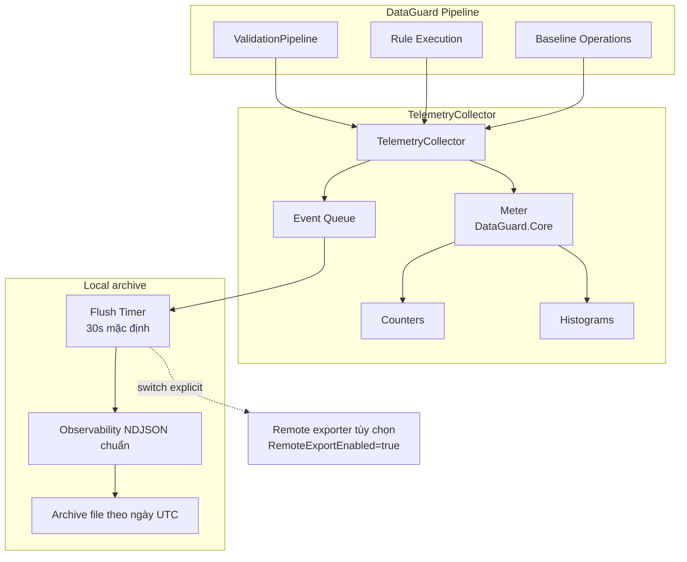

# Telemetry

> Nguồn: `src/DataGuard.Core/Telemetry/TelemetryCollector.cs`

Hệ thống telemetry của DataGuard là **opt-in, chỉ local** theo mặc định. Nó sử dụng
`System.Diagnostics.Metrics` (tiêu chuẩn .NET 9) và tự động ghi envelope observability bounded,
allowlist vào file archive NDJSON theo ngày UTC khi được bật. Legacy NDJSON HTTP exporter chỉ còn là
compatibility path explicit; `RemoteExportEnabled` mặc định `false` và không gọi endpoint ngầm.
Xem [`local-file-observability.md`](../../observability/local-file-observability.md).

## Luồng Telemetry



## TelemetryCollector

Collector trung tâm sử dụng `System.Diagnostics.Metrics`.

```csharp
public sealed class TelemetryCollector : IDisposable, IAsyncDisposable
{
    private readonly Meter _meter;
    private readonly TelemetryConfig _config;
    private readonly ConcurrentDictionary<string, Counter<long>> _counters = new();
    private readonly ConcurrentDictionary<string, Histogram<double>> _histograms = new();
    private readonly ConcurrentQueue<TelemetryEvent> _eventQueue = new();
    private readonly Timer? _flushTimer;

    public TelemetryCollector(TelemetryConfig config, Func<string, string, Task>? exportSink = null) { ... }
}
```

### Quyết Định Thiết Kế Chính

| Quyết định | Lý do |
|------------|-------|
| **Chỉ opt-in** | `TelemetryConfig.Enabled = false` theo mặc định |
| **Local archive trước** | Event và metric ghi vào NDJSON theo ngày, không egress mạng |
| **APIs .NET tiêu chuẩn** | Sử dụng `System.Diagnostics.Metrics` cho tương thích OpenTelemetry |
| **Bounded/fail-open** | Giới hạn queue/payload/record, đo drop mà không fail validation |
| **Remote switch** | `RemoteExportEnabled=false` khóa HTTP exporter compatibility |

`FlushAsync(CancellationToken)` là API flush bất đồng bộ được bổ sung. Một flush gate duy nhất ngăn export chồng nhau; export lỗi hoặc bị hủy đưa events đã lấy ra trở lại queue để retry. `FlushEvents(object?)` vẫn giữ cho caller cũ và chờ cùng đường thực thi. `TelemetryFlushResult` cho phép quan sát các trạng thái no-work, in-progress, circuit-open, rejected-endpoint, failed/cancelled và exported. Endpoint bị từ chối chủ động bỏ queue vì không có đích hợp lệ để gửi.

Vòng đời collector là `Active → Stopping → Stopped`. `DisposeAsync()` chuyển qua các
trạng thái này, dừng timer và thử flush cuối có giới hạn; event mới bị từ chối sau
`Stopping`. `TerminalLossCount` cho biết các event còn trong queue nhưng không thể
gửi khi shutdown hoàn tất. `Dispose()` đồng bộ cũ chỉ best effort. Nếu delegate export cũ không kết thúc trước timeout, collector giữ batch
và giữ single-flight gate đến khi delegate kết thúc, nên các timer tick không tạo
nhiều export chồng lấp.

## TelemetryConfig

```csharp
public sealed record TelemetryConfig(
    bool Enabled = false,
    string? ExportEndpoint = null,
    int FlushIntervalSeconds = 30,
    bool IncludeStackTraces = false);
```

| Trường | Mặc định | Mô tả |
|--------|----------|-------|
| `Enabled` | `false` | Công tắc ghi/flush; tắt ghi không có nghĩa object không cấp phát tài nguyên |
| `ExportEndpoint` | `null` | URL compatibility: HTTPS hoặc HTTP loopback; remote built-in cần bật remote và không có file sink đang hoạt động |
| `FlushIntervalSeconds` | `30` | Khoảng thời gian timer cho flush events |
| `IncludeStackTraces` | `false` | Option constructor legacy; collector hiện không dùng để thu thập hoặc loại stack trace |
| `MaxQueuedEvents` | `10.000` | Số event tối đa trong queue cộng batch đang chạy; event mới hơn bị bỏ khi đầy |
| `MaxBatchEvents` | `1.000` | Số event tối đa trong một export request |
| `MaxPayloadBytes` | `1.048.576` | Giới hạn byte UTF-8 mỗi request; event đơn lẻ quá lớn sẽ bị bỏ |
| `ExportTimeoutSeconds` | `5` | Thời gian chờ có giới hạn cho một delegate export |
| `FileSinkEnabled` | `true` | Archive local chính khi không inject exporter delegate |
| `FileSinkDirectory` | local app-data của OS | Gốc thư mục archive `yyyy/MM/dd/` |
| `FileSinkFilePrefix` | `observability` | Prefix file hằng ngày |
| `ServiceName` / `ServiceVersion` / `EnvironmentName` | `dataguard` / `unknown` / `local` | Resource metadata bounded |
| `RemoteExportEnabled` | `false` | Công tắc network legacy do owner kiểm soát |
| `IncludeEventDetails` | `false` | Body event tùy chọn, đã redact/cap; mặc định không body |
| `MaxRecordBytes` | `65.536` | Kích thước tối đa một record local |

Các giới hạn là init property được thêm vào nên primary constructor và deconstruction
hiện có không đổi. `DroppedEventCount` cho biết event mất do giới hạn queue, payload
hoặc endpoint bị từ chối.

## Metrics

### Counters

| Counter | Tags | Mô tả |
|---------|------|-------|
| `rule.executions` | `rule`, `success` | Số lần thực thi mỗi rule |
| `validations.total` | — | Tổng số lần validation |
| `violations.total` | — | Tổng violations tìm thấy |
| `violations.errors` | — | Violations mức Error |
| `violations.warnings` | — | Violations mức Warning |

### Histograms

| Histogram | Đơn vị | Tags | Mô tả |
|-----------|--------|------|-------|
| `rule.duration` | ms | `rule`, `success` | Thời gian thực thi mỗi rule |
| `validation.contracts` | — | — | Contracts mỗi lần validation |
| `validation.duration` | ms | — | Tổng thời gian validation |

### Phương Thức Ghi

```csharp
// Tăng counter
collector.IncrementCounter("rule.executions", 1, new[] {
    new KeyValuePair<string, object?>("rule", "DG002"),
    new KeyValuePair<string, object?>("success", "true"),
});

// Giá trị histogram
collector.RecordHistogram("rule.duration", 42.5, new[] {
    new KeyValuePair<string, object?>("rule", "DG002"),
});

// Operation có hẹn giờ (histogram tự động)
using (collector.MeasureOperation("rule.duration"))
{
    await rule.ValidateAsync(contract, allContracts, ct);
}

// Ghi event
collector.RecordEvent("BaselineCreated", "New baseline created", new Dictionary<string, object?>
{
    ["violationCount"] = 42,
    ["schemaVersion"] = "1.0",
});
```

## TimedOperation

Ghi histogram tự động qua mẫu `IDisposable`:

```csharp
public sealed class TimedOperation : IDisposable
{
    private readonly Stopwatch _stopwatch = Stopwatch.StartNew();

    public void Dispose()
    {
        _stopwatch.Stop();
        _collector.RecordHistogram(_operationName, _stopwatch.Elapsed.TotalMilliseconds, _tags);
    }
}
```

Sử dụng:
```csharp
using (collector.MeasureOperation("validation.total"))
{
    // Khối code được đo thời gian
}
// Tự động ghi thời gian vào histogram
```

## TelemetryEvent

Theo dõi dựa trên event cho dữ liệu không phải số:

```csharp
public sealed record TelemetryEvent(
    DateTimeOffset Timestamp,
    string EventType,
    string Details,
    IReadOnlyDictionary<string, object?> Properties);
```

Events được xếp hàng và flush định kỳ đến local archive. `TelemetryEvent` vẫn giữ cho injected
export legacy; đường file dùng envelope `ObservabilityRecord` an toàn hơn.

## Cơ Chế Export

### Định Dạng NDJSON

Ví dụ dưới đây là `TelemetryEvent` legacy dùng cho injected/compatibility exporter, không phải schema file local. File local dùng envelope `ObservabilityRecord` (signal, event_name, resource, attributes) theo [hướng dẫn file sink](../../observability/local-file-observability.md):

```json
{"Timestamp":"2026-08-25T10:30:00Z","EventType":"BaselineCreated","Details":"New baseline","Properties":{"violationCount":42}}
{"Timestamp":"2026-08-25T10:30:01Z","EventType":"ValidationComplete","Details":"Validation finished","Properties":{"duration":1500}}
```

### Xác Thực Endpoint

```csharp
private static bool IsAllowedExportEndpoint(string? endpoint)
{
    if (uri.Scheme == Uri.UriSchemeHttps) return true;
    return uri.Scheme == Uri.UriSchemeHttp
        && (uri.IsLoopback || uri.Host == "localhost");
}
```

Chỉ compatibility exporter explicit mới dùng endpoint validation. File sink native không tạo hoặc
gọi endpoint.

### Circuit Breaker

Sau 3 lần thất bại export liên tiếp, collector dừng export cho đến khi tạo instance mới:

```csharp
private const int MaxConsecutiveExportFailures = 3;

if (_consecutiveExportFailures >= MaxConsecutiveExportFailures)
    return; // Dừng export
```

Điều này ngăn lỗi telemetry ảnh hưởng đến validation pipeline.

## Tích Hợp Với ValidationPipeline

```csharp
var pipeline = DataGuardApi.CreatePipeline(config)
    .WithTelemetry(new TelemetryConfig(
        Enabled: true)
    {
        FileSinkDirectory = "/var/lib/dataguard/observability/archive",
        RemoteExportEnabled = false,
    });

var result = await pipeline.ValidateAsync(contracts);
// Telemetry tự động ghi nhận
```

## Kiểm soát riêng tư và giới hạn

| Kiểm soát | Triển khai |
|----------|------------|
| **Opt-in** | `Enabled = false` theo mặc định |
| **Giảm dữ liệu envelope local** | Allowlist attributes; body tùy chọn redact theo pattern và giới hạn độ dài, không bảo đảm không có secret |
| **Local-first** | Metrics/event archive local qua async write bounded |
| **Không endpoint ngầm** | Remote cần `RemoteExportEnabled=true`; host routes là opt-in riêng |
| **Circuit breaker** | 3 lần thất bại → dừng export |
| **Shared HttpClient** | Chỉ áp dụng legacy exporter compatibility (SEC-005) |

File sink local và exporter legacy/custom có ranh giới tin cậy khác nhau. Inject `exportSink` bỏ qua lựa chọn file sink và cờ `RemoteExportEnabled` built-in. Delegate là code ứng dụng được tin cậy; details/properties của `TelemetryEvent` legacy không đi qua allowlist envelope local. Endpoint built-in từ chối user information/query/fragment, nhưng cho phép mọi host HTTPS và HTTP loopback; đây không phải allowlist đích do operator sở hữu hay bảo đảm chặn redirect. Lỗi export có thể ghi exception message ra stderr. Không đưa secret vào details, tên/tag metric, resource label hoặc exception message.

`IncludeStackTraces` giữ tương thích API, không phải cờ redact đang hoạt động. Gọi `WithTelemetry()` không tham số là bật thu thập tường minh; config tạo trực tiếp vẫn mặc định `Enabled=false`. Pipeline ghi summary validation; caller khác phải gọi phương thức ghi tương ứng. Sơ đồ không chứng minh mọi CLI/rule path đã được instrument. Tương thích Metrics API không có nghĩa exporter OpenTelemetry/OTLP đã cài hoặc cấu hình. Circuit breaker giới hạn retry, không biến telemetry thành kênh audit bảo đảm giao nhận.

Nguồn đối chiếu: constructor, `RecordEvent`, `FlushAsync`, `IsAllowedExportEndpoint` trong `TelemetryCollector.cs`; `ObservabilityFileSink.cs`/`ObservabilityRecordFactory`; `PublicApi/PublicApiSurface.cs` (`WithTelemetry`, summary). Đợt audit tài liệu không chạy export mạng hoặc process editor/host.

## Trace thực thi graph local (schema 1)

EventSource BCL `DataGuard-Validation` bổ sung luồng chẩn đoán opt-in độc lập tại `GraphValidationExecutor` dùng chung CLI/API. Giữ nguyên mặc định telemetry/file/export. Không có listener thì trả task executor trực tiếp, không thêm async wrapper; listener chỉ mức Error không bật event Informational này. Có chi phí khởi tạo provider một lần. Chưa instrument analyzer netstandard, Visual Studio net472, extraction, baseline hay compiler/evaluator.

Event khai báo 1/2 chỉ có trường số allowlist; không SQL/source, ID contract/rule, path, content hash, row data, connection string, exception message/type name. EventSource có thể có event chẩn đoán nội bộ 0 riêng. requestId là sequence theo process, không lấy từ bí mật; request lồng nhau/đồng thời có ID riêng, không lưu ambient parent.

| ID / version | Event | Trường |
|---|---|---|
| 1 / 1 | RequestBegin | requestId:int64, contracts:int32 (-1 nếu chưa biết), concurrent:int32 (0/1) |
| 2 / 1 | RequestEnd | requestId:int64, elapsedMs:double, outcome:int32, violations:int32, unevaluated:int32, dropped:int32, reasonFlags:int32 |

Outcome: 0 hoàn tất, 1 incomplete/unevaluated, 2 caller hủy, 3 timeout được propagate, 4 lỗi propagate khác. Lỗi rule đã được engine giữ lại vẫn là incomplete. reasonFlags: 1 chạm giới hạn output violations, 2 có unevaluated, 4 rule lỗi, 8 rule unavailable, 16 timeout rule thuộc loại biết trước (TimeoutException/RegexMatchTimeoutException). Count chưa biết là -1. Không copy chuỗi reason tùy ý; chưa có taxonomy parser-budget hay cache metric.

Elapsed bắt đầu sau khi gửi Begin, kết thúc trước đếm outcome/gửi End: bao gồm chạy graph và drain/sort kết quả, không gồm baseline, không phải thời gian evaluator. Đếm outcome có chi phí theo số rule nằm ngoài interval. Listener có thể chạy đồng bộ: dùng listener tin cậy, nhanh; không hứa zero overhead hoặc kiểm soát IO của listener. Lỗi listener/đọc metadata không được thay kết quả/lỗi validation.

Giới hạn nhận 1.000 request trong 60 giây từ request đầu, tính cả vòng đời process và dùng chung mọi listener; reconnect không reset. Tối đa 2.000 event khai báo; không queue/timer/disk sink/network exporter mới. Request đã nhận có thể kết thúc sau 60 giây. Listener ngắt/capture dừng có thể thiếu End; không phải audit log bền vững. Khởi động lại child chẩn đoán để capture mới. Hết quota đi đường executor không wrapper.

Ví dụ End đã làm sạch: `{"requestId":7,"elapsedMs":2.4,"outcome":1,"violations":3,"unevaluated":1,"dropped":0,"reasonFlags":2}`.

Với dotnet-trace chính thức đã cài, ví dụ child local an toàn:

```sh
dotnet-trace collect --providers DataGuard-Validation:0xFFFFFFFFFFFFFFFF:4 --duration 00:00:30 --buffersize 16 --rundown false --output ./validation.nettrace -- dotnet ./DataGuard.Cli.dll validate --ide-safe --project ./synthetic-fixture --format json
```

Thư mục synthetic-fixture phải tồn tại và chứa source giả lập không nhạy cảm. `--ide-safe` ngăn chạy project code/kết nối DB thật. Validation có thể exit khác 0 do findings/unevaluated, không đồng nghĩa collector cài lỗi. Không đặt bí mật trong arguments: metadata EventPipe có thể chứa arguments/path độc lập với provider. Capture giới hạn 30 giây, buffer RAM 16 MB; buffer không phải quota cứng của file. Payload provider bị giới hạn bởi schema số cố định/2.000 event, nhưng runtime metadata thêm overhead. Tắt bằng dừng collector/disable listener. Trace giữ local, không tự upload. Bật runtime profiling là opt-in rộng hơn và có thêm metadata.

Dùng all-keywords chỉ cho provider như lệnh trên, không dùng `:0:4`: đường ghi object-array của .NET 9 EventPipe có thể lọc session keyword-zero khác overload tối ưu. Đã kiểm chứng native với dotnet-trace 9.0.661903/.NET 9.0.21, đủ hai event ID và trường concurrent.
