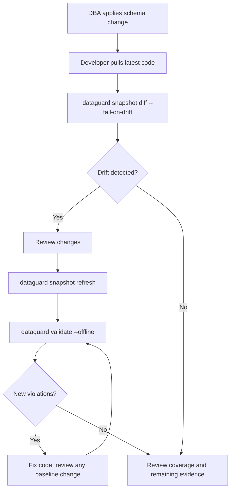

# Operations Playbook

These examples assume an exact reviewed CLI build/artifact is already installed and on PATH; `dataguard version` checks the command, not installation. See the [installation guide](installation-guide.md). Public NuGet availability is not assumed.

Live examples use `DATAGUARD_DB` supplied by an approved session/CI secret mechanism; do not put its value in command arguments. Source checked at `ca68a3159425495f771da866188df75a8237ab4b`: YAML uses PascalCase as defined by `ConfigDocument`. Runtime checks still needed are the actual database/schema, audit/secret backend and CI upload on the target host.

## Daily Operations

### Morning Check (CI Pipeline)

```bash
# Check latest CI status
gh run list --limit 5

# If validation failures, check details
gh run view <run-id> --log-failed
```

### Schema Change Workflow



### Baseline Management

```bash
# Create baseline for legacy codebase
dataguard baseline --connection-env DATAGUARD_DB --provider oracle

# Check what's baselined
cat .dataguard-baseline.json | jq '.Violations | length'

# Re-baseline after fixing violations
dataguard baseline --connection-env DATAGUARD_DB --provider oracle

# Migrate v1 baseline to v2
dataguard migrate --baseline .dataguard-baseline.json
```

### Snapshot Management

```bash
# Refresh snapshot from database
dataguard snapshot refresh --connection-env DATAGUARD_DB --provider oracle

# Show snapshot info
dataguard snapshot show

# Check for drift
dataguard snapshot diff --connection-env DATAGUARD_DB --provider oracle --fail-on-drift
```

## Team Workflows

### New Project Onboarding

```bash
# 1. Check the previously provisioned CLI
dataguard version

# 2. Initialize config
dataguard init --provider oracle

# 3. Create initial snapshot
dataguard snapshot refresh --connection-env DATAGUARD_DB --provider oracle

# 4. Run first validation
dataguard validate --offline --verbose

# 5. Create baseline for existing violations
dataguard baseline --connection-env DATAGUARD_DB --provider oracle

# 6. Commit config files
# Review metadata and permissions before committing; no commit is automatic.
```

### PR Review Checklist

- [ ] `dataguard validate` passes (exit code 0)
- [ ] No new violations beyond baseline
- [ ] Snapshot updated if schema changed
- [ ] New entities have `[ExpectedColumn]` attributes (Manual mode)
- [ ] New SP calls have `[ExpectedSpParameter]` attributes

### Release Process

```bash
# 1. Full validation
dataguard validate --format sarif --output release-validation.sarif

# 2. Snapshot diff
dataguard snapshot diff --fail-on-drift

# 3. Assessment
dataguard assess --format json --output assessment.json

# 4. Commit artifacts
# Retain approved reports in an access-controlled evidence location.
```

## Environment-Specific Configs

### Development

```yaml
GroundTruthMode: Manual
AllowPlaintextConfigFallback: true
EnableAuditLogging: false
```

### Staging

```yaml
GroundTruthMode: Full
ConnectionString: null  # Use DATAGUARD_DATAGUARD_CONNECTION_STRING env var
EnableAuditLogging: true
AuditLogPath: "/var/log/dataguard/audit.jsonl"
```

### Production CI

```yaml
GroundTruthMode: Snapshot
SnapshotFilePath: ".dataguard-snapshot.json"
EnableAuditLogging: true
EnableCredentialRotationDetection: true
```

## Monitoring

### Suggested monitoring checks

| Metric | Source | Alert Threshold |
|--------|--------|-----------------|
| Validation duration | TelemetryCollector | Team-defined; measure first |
| Violation count | Validation output | New violations beyond baseline |
| Schema drift | snapshot diff | Any drift |
| Credential rotation | CredentialManager | Review available credential metadata |
| Audit log integrity | FileAuditLogger | Chain break |

These are monitoring proposals, not preconfigured alerts. A configured rotation warning is not proof that a credential has an issuer expiry date.

### Health Checks

```bash
# Verify DataGuard installation
dataguard version

# Verify config
dataguard config validate

# Verify database connectivity
dataguard validate --verbose --connection-env DATAGUARD_DB
```
