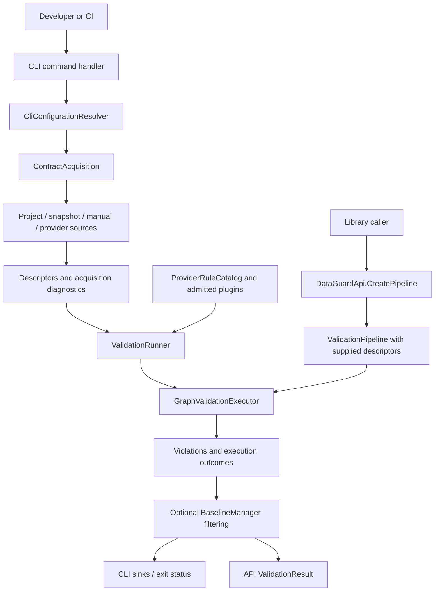
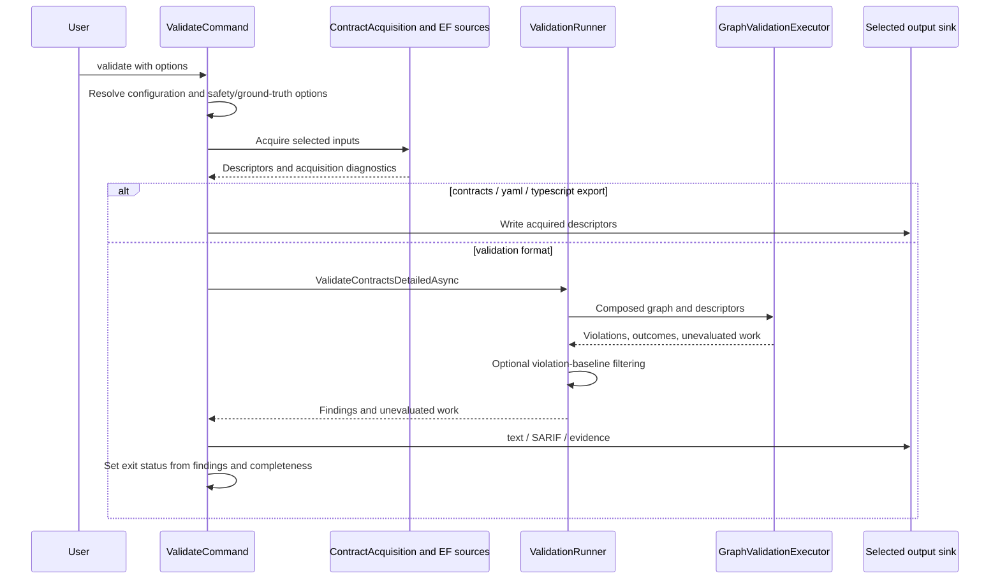

# Tương Tác Thành Phần / Component Interaction

Source reconciliation: 2026-10-18. The earlier 2025-01-19 diagrams were illustrative and included APIs that are not current. The interactions below describe source wiring, not executed runtime evidence.

Đối chiếu source không thay thế kiểm thử runtime. CLI, API thư viện và Roslyn host là các entrypoint riêng.

## Tổng Quan Tương Tác / Interaction Overview

The CLI uses [ValidationRunner](../src/DataGuard.Cli/Services/ValidationRunner.cs), not `new ValidationPipeline(config)`. The public pipeline constructor is internal; external callers use `DataGuardApi.CreatePipeline(config)`. Both paths invoke the shared executor. The API caller supplies extracted contracts and explicitly composes provider rules when required.

## CLI → Acquisition → Validation

See [ValidateCommand](../src/DataGuard.Cli/Commands/ValidateCommand.cs). Export success does not mean validation succeeded. `typescript` exports entity descriptors before the rule-validation branch. Unavailable rules, Unknown type mappings and partial acquisition must remain distinct from a clean result.

Xuất descriptor không phải xác thực contract. Không diễn giải thiếu finding là pass nếu acquisition hoặc rule chưa đánh giá được.

## API Thư Viện / Library API

[PublicApiSurface.cs](../src/DataGuard.Core/PublicApi/PublicApiSurface.cs) exposes `DataGuardApi.CreatePipeline`, `WithProviderRules`, `WithRules`, `WithPlugins` and `ValidateAsync(contracts, cancellationToken)`. `ValidateAsync` runs the composed graph, optionally filters a violation baseline, records enabled telemetry and returns `ValidationResult`, including execution status, dropped count, rule outcomes and unevaluated contracts. It does not discover an EF model, invoke every adapter or write SARIF automatically.

API nhận descriptors đã thu thập. Caller chịu trách nhiệm nguồn, composition provider và cách xuất kết quả.

## Adapter → Database

[ContractAcquisition](../src/DataGuard.Cli/Services/ContractAcquisition.cs) selects the configured provider; it does not query all databases in parallel. SQL Server uses catalog queries and first-result metadata description. Oracle reads catalog/NLS information; REF CURSOR execution requires `Oracle.DescribeRefCursors` and an eligible subprogram. PostgreSQL and MySQL routine metadata have different result-shape limits.

The reviewed adapter guides specify those boundaries: [SQL Server](03-components/adapters/sqlserver-adapter.md), [Oracle](03-components/adapters/oracle-adapter.md), [PostgreSQL](03-components/adapters/postgresql-adapter.md), [MySQL](03-components/adapters/mysql-adapter.md).

## Thứ Tự và Song Song / Ordering and Concurrency

[RuleDependencyGraph](../src/DataGuard.Core/Rules/RuleDependencyGraph.cs) computes order/groups. [GraphValidationExecutor](../src/DataGuard.Core/Validation/ConcurrentValidationEngine.cs) runs groups in dependency order, with bounded concurrent rule-contract batches when enabled. The detailed path uses `Parallel.ForEachAsync`, not the previously illustrated `Partitioner.Create` plus semaphore flow. Sequential execution is also supported.

Rule failures and result-cap overflow make execution incomplete; cancellation is propagated. Progress observers do not determine validation outcomes. Scheduling diagrams are not performance measurements.

## Baseline và Snapshot / File Interactions

[BaselineCommand](../src/DataGuard.Cli/Commands/BaselineCommand.cs) disables existing baseline suppression while collecting current findings, then persists them. Unevaluated contracts are reported but are not baseline findings. [SnapshotCommands](../src/DataGuard.Cli/Commands/SnapshotCommands.cs) separately acquires schema/procedure metadata and writes v4 snapshots; `snapshot diff` compares structural metadata against fresh acquisition unless the explicit legacy violation-diff option is selected.

Baseline suppresses findings; snapshot stores schema ground truth. Writing one is not an implicit update of the other. See [BaselineManager](../src/DataGuard.Core/Baseline/BaselineManager.cs) and [snapshot conversion/model](../src/DataGuard.Core/Baseline/SnapshotModel.cs).

## IDE, Analyzer và Code Fix / Editor Interaction

[UnvalidatedSqlCallGenerator](../src/DataGuard.Analyzers/UnvalidatedSqlCallGenerator.cs) uses incremental syntax classification for DG001 without database I/O. Diagnostic analyzers run under the Roslyn host; CLI validation remains separate. [CodeFixes](../src/DataGuard.CodeFixes/CodeFixProviders.cs) offer actions only for supported diagnostics and available context. The host applies an action after user selection and reanalyzes; the original diagnostic is not guaranteed to disappear, and a suppression attribute does not validate SQL.

Không giả định mọi diagnostic có quick fix hoặc quick fix đảm bảo đúng ngữ nghĩa/database.

## Bảo Mật và Plugin / Security and Plugin Interactions

[ZeroTrustCredentialProvider](../src/DataGuard.Core/Security/ZeroTrustCredentialProvider.cs) consults configured stores in order; AWS is host-registered by the CLI. Local protection is platform-specific; plaintext fallback requires explicit configuration. These are credential lookup boundaries, not permission to send a token to arbitrary endpoints.

[RulePluginManager](../src/DataGuard.Core/Plugins/RulePluginManager.cs) calls admission checks before loading verified bytes in a collectible context. MEF discovers `IContractRule` exports after admission, then metadata is read from export types; the previous `GetExports<IContractRule, IRuleMetadata>` diagram did not match MEF 2 usage. Plugins run in-process, so admission is not process isolation.

For supported security and telemetry configuration, see [security](03-components/core/security.md) and [telemetry](03-components/core/telemetry.md). These components are not unconditional steps in every validation call.

## Health và CI/CD / Health and CI/CD

[DataGuard.Host](../src/DataGuard.Host/Program.cs) explicitly opts into a loopback HTTP host and endpoint exposure. Local background probes publish cached snapshots; HTTP reads do not trigger database, credential or supply-chain checks. Startup reflects a completed probe refresh; readiness also requires healthy components and fresh state. See [HealthProbeCoordinator](../src/DataGuard.Core/Health/HealthProbeCoordinator.cs).

CI jobs and release jobs have their own dependencies and conditions in [ci.yml](../.github/workflows/ci.yml) and [release.yml](../.github/workflows/release.yml). They are not a single component call chain. Marketplace publication remains paused under the [publishing guide](marketplace-publishing.md).

No runtime, database, editor-host, Windows or hosted workflow checks were executed for this documentation-only review.
