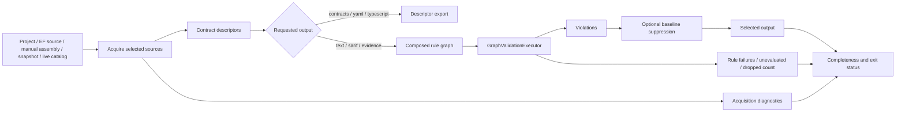

# Luồng Dữ Liệu / Data Flow

Source reconciliation: 2026-10-18. Earlier examples were dated 2025-01-19; the current flow below replaces obsolete illustrative APIs. This is source-level evidence, not a runtime/performance result.

## Tổng Quan / Overview

The CLI selects applicable sources; it does not always extract EF, SQL Server, Oracle and raw SQL in parallel. The public API begins at caller-supplied descriptors. Sources: [ContractAcquisition](../src/DataGuard.Cli/Services/ContractAcquisition.cs), [ValidateCommand](../src/DataGuard.Cli/Commands/ValidateCommand.cs), [public pipeline](../src/DataGuard.Core/PublicApi/PublicApiSurface.cs).

CLI chọn nguồn theo cấu hình; API nhận descriptors sẵn có. Không suy ra coverage đầy đủ chỉ vì một nguồn trả về thành công.

## 1. EF Model và Source Extraction

[EfModelSource](../src/DataGuard.Core/Sources/EfModelSource.cs) supports extraction from a supplied runtime `DbContext` model. Its ModelSnapshot entrypoints route C# source through [ModelSnapshotCSharpParser](../src/DataGuard.Core/Sources/ModelSnapshotCSharpParser.cs), not a JSON representation of `BuildModel`. The diagnostic-returning API preserves partial-parse diagnostics; failure to parse any entity throws an extraction exception.

`validate --ef-snapshot` and EF project/context selection are handled by [ValidateCommand](../src/DataGuard.Cli/Commands/ValidateCommand.cs). IDE-safe source extraction does not require loading or executing the user's DbContext assembly. Supported snapshot syntax is bounded; source parsing is not full execution of arbitrary EF configuration.

ModelSnapshot là C# source. Phần không phân tích được phải thể hiện là acquisition chưa đầy đủ, không tự coi là model hợp lệ.

## 2. Database Contracts

| Provider | Catalog input | Result-shape boundary |
|---|---|---|
| SQL Server | `sys.procedures`, `sys.parameters`, types, table metadata | `sp_describe_first_result_set`; metadata failures can leave unknown shapes |
| Oracle | `ALL_ARGUMENTS`, `ALL_PROCEDURES`, columns and NLS | REF CURSOR catalog flag is not its shape; explicit eligible-subprogram execution opt-in is required for describe |
| PostgreSQL | `pg_proc`, `pg_namespace`, `pg_type`, columns/materialized views | RETURNS TABLE arguments become result columns; no function-body inference |
| MySQL | `information_schema.ROUTINES`, `PARAMETERS`, columns | Routine descriptors have empty result columns; functions retain return type |

Live raw-query description is a separate provider path. Supported catalog extraction does not imply every query grammar or result type is supported. See the [adapter guides](03-components/adapters/sqlserver-adapter.md) and their EN/VI provider counterparts.

## 3. Raw SQL and Source Locations

Project acquisition extracts supported C# SQL call sites and metadata into `RawSqlDescriptor` values. SQL Server's adapter supplies ScriptDOM grammar parsing; providers without an injected grammar retain acquisition errors and otherwise report applicable syntax checks unevaluated. Unknown type compatibility is also unevaluated, not compatible.

[RawSqlParseStatusRule](../src/DataGuard.Core/Rules/RawSqlParseStatusRule.cs) resolves parser offsets through available source-map segments, falling back to the contract location when no mapping exists. SQL-relative parser coordinates and a C# source location are not interchangeable. Unsupported or dynamic expressions must not be represented as fully analyzed SQL.

Không đánh đồng tọa độ SQL với tọa độ source C#; mapping chỉ chính xác trong phần nguồn có ánh xạ.

## 4. Rule Processing

[ValidationRunner](../src/DataGuard.Cli/Services/ValidationRunner.cs) composes provider rules/plugins and applies selected exclusions. [GraphValidationExecutor](../src/DataGuard.Core/Validation/ConcurrentValidationEngine.cs) honors the dependency graph, runs sequentially or in bounded concurrent batches, and returns violations plus completeness information. Dependency groups come from current registered rules, not the old fixed six-group illustration.

Rule exceptions, dropped findings and unevaluated contracts are separate outcome data. They are not findings suitable for a suppression baseline and must not silently become passes.

## 5. Baselines versus Schema Snapshots

| Artifact | Data and purpose | Command/path |
|---|---|---|
| Violation baseline | Recorded findings/fingerprints used to suppress existing findings | `baseline`; optional filtering during validation |
| Schema snapshot | Persisted tables/procedures, provider/schema scope, metadata and integrity hash | `snapshot refresh`; offline acquisition; structural `snapshot diff` |

Current schema snapshots use format v4 with `canonical-schema-v2` hashing. Legacy snapshot/baseline compatibility does not make a violation-set hash structural schema evidence. `snapshot diff` needs fresh schema acquisition for structural comparison; `--legacy-violation-diff` explicitly selects deprecated finding comparison.

See [SnapshotCommands](../src/DataGuard.Cli/Commands/SnapshotCommands.cs), [SnapshotModel](../src/DataGuard.Core/Baseline/SnapshotModel.cs), [SnapshotComparer](../src/DataGuard.Core/Baseline/SnapshotComparer.cs) and [BaselineManager](../src/DataGuard.Core/Baseline/BaselineManager.cs).

Snapshot refresh là hành động ghi tường minh; live validate không tự cam kết refresh. Baseline lọc finding cũ, không phải bản schema.

## 6. Output and Completion

Validation formats are `text`, `sarif` and `evidence`. The CLI creates the selected sink/writer; it does not always emit every format or Markdown. A supplementary SARIF `summary.json` write can fail with a visible warning without replacing the primary report.

`contracts`, `yaml` and `typescript` return from the export branch before rule validation. [TypeScriptContractWriter](../src/DataGuard.Core/Reporting/ContractExport.cs) writes interfaces from entity descriptors, marks nullable properties optional, maps date/time CLR types to `string` and unknown types to `unknown`. It is not API/frontend compatibility validation or a guarantee about serializer behavior.

For `validate`, exit 0 means no blocking errors under the selected completeness policy, 1 means findings/errors or a caught operation failure, 2 covers rejected options/configuration paths, 3 covers unevaluated/incomplete work, and cancellation uses 130. Explicit flags can relax selected completeness gates; a zero exit under such flags is not complete coverage. See [ValidateCommand](../src/DataGuard.Cli/Commands/ValidateCommand.cs) and [Program](../src/DataGuard.Cli/Program.cs).

## Ground-Truth Modes / Chế Độ Ground Truth

- **Offline/snapshot:** uses persisted metadata and selected local sources without a live database connection; snapshot integrity/provider checks still apply.
- **Live:** acquires provider metadata with an authorized configured connection; metadata acquisition/description can fail or be unsupported.
- **Manual:** uses declared contract metadata from the selected assembly; expected metadata is not evidence that a live database matches it.

No sub-second, fixed-minute, latency target, 100% correctness or coverage claim follows from these modes. Runtime, live-database, Windows/editor-host and performance checks were not run during this documentation review.
