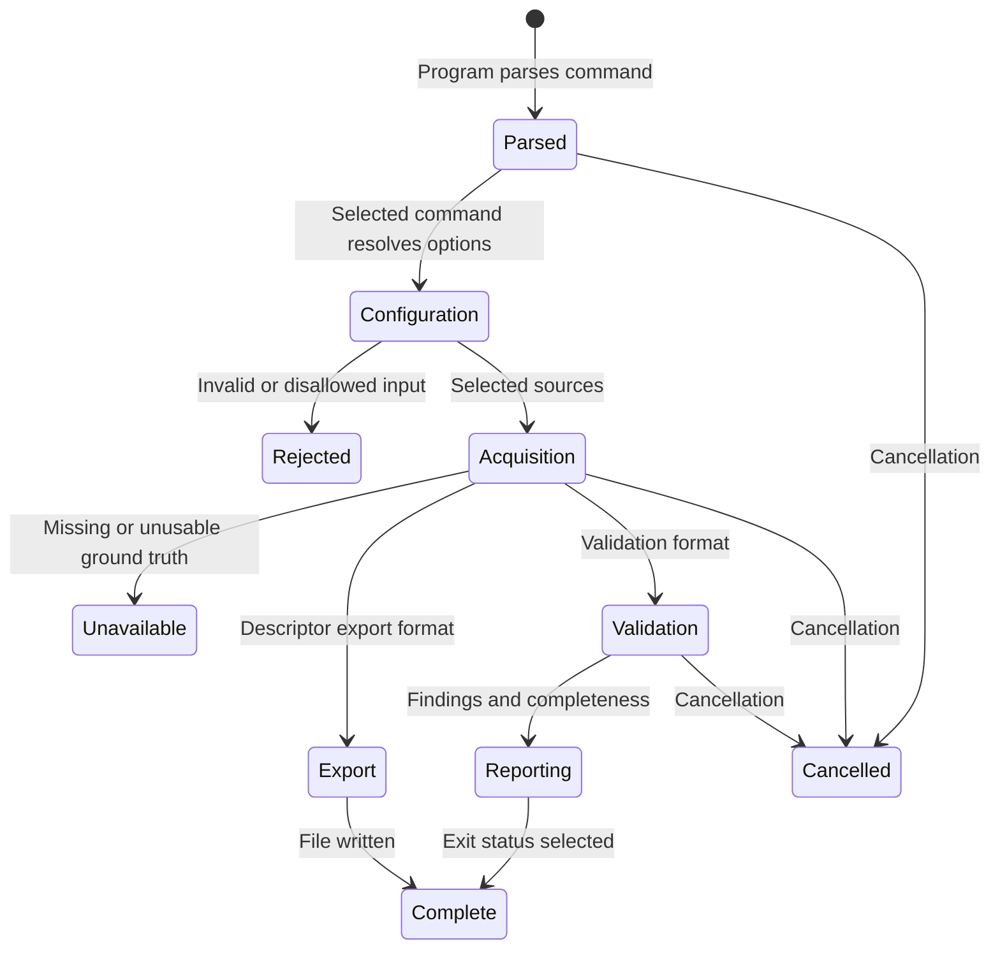
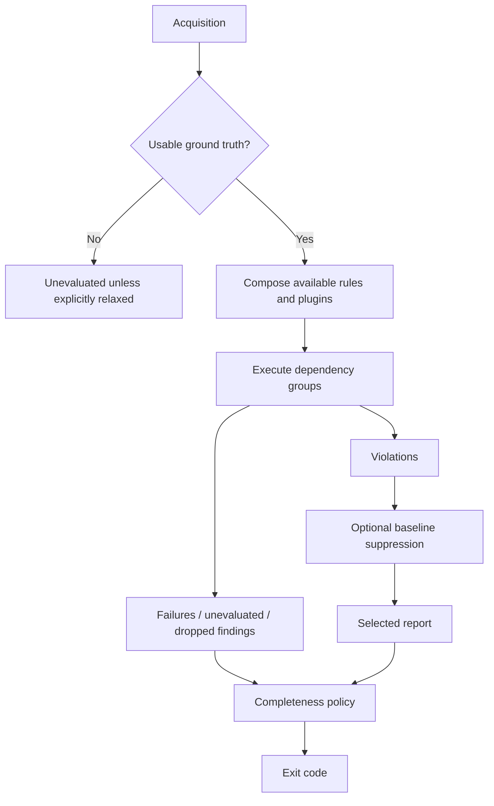
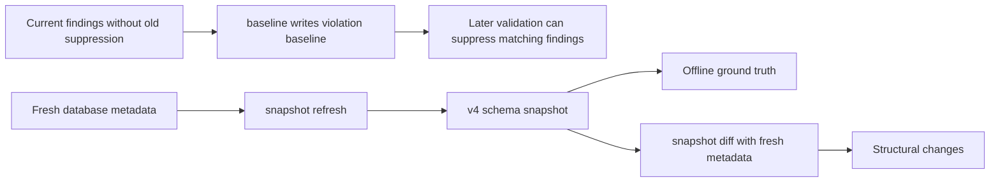

# Luồng Giai Đoạn & Trạng Thái / Stage & Status Flow

Source reconciliation: 2026-10-18. The prior document was dated 2025-01-19 and illustrated hypothetical transitions. Current state boundaries below come from source, not executed runtime tests.

## Vòng Đời CLI / CLI Lifecycle

This is a conceptual branch map, not a list of enum states. Command handlers have distinct options and error handling. `init`, `validate`, `baseline` and `snapshot` are independently invocable commands, not a mandatory state machine that automatically merges or deploys code.

Các bước merge/deploy thuộc quy trình của repository/owner, không phải tác dụng tự động của DataGuard.

## Validation States / Trạng Thái Xác Thực

[ValidateCommand](../src/DataGuard.Cli/Commands/ValidateCommand.cs) resolves inputs and safe-execution constraints, checks snapshot prerequisites, acquires descriptors and selects export or validation. Validation uses [ValidationRunner](../src/DataGuard.Cli/Services/ValidationRunner.cs) and [GraphValidationExecutor](../src/DataGuard.Core/Validation/ConcurrentValidationEngine.cs).

Export formats bypass rule validation; their completion must not be labeled “contracts passed”. Missing/unsupported work is separate from mismatches. Warnings alone do not necessarily fail the default error-severity gate.

### `validate` Exit Status

| Code | Meaning / Ý nghĩa |
|---|---|
| 0 | No blocking error under the selected policy; export commands may also complete without validation |
| 1 | Error-severity findings or caught operational failure |
| 2 | Invalid/disallowed options or configuration paths |
| 3 | Unevaluated/incomplete work or failed completeness prerequisites |
| 130 | Cancellation |

`--allow-unevaluated`, `--allow-syntactic-only` and `--fail-on-unavailable` affect different gates. Their semantics are in the handler; they do not convert unknown evidence into validated evidence. These codes describe `validate`/top-level cancellation, not a promise that every subcommand shares the same status mapping.

## Baseline và Snapshot / Artifact States

[BaselineCommand](../src/DataGuard.Cli/Commands/BaselineCommand.cs) disables old baseline filtering before writing current findings. Unevaluated contracts are not saved as findings. [SnapshotCommands](../src/DataGuard.Cli/Commands/SnapshotCommands.cs) writes schema snapshots separately; `show` reads metadata, and structural `diff` requires fresh database metadata. Legacy violation diff is an explicit compatibility mode, not structural drift detection.

Manual expected attributes are another ground-truth source; they do not mutate a persisted baseline or snapshot automatically.

## Command Registration / Đăng Ký Lệnh

[Program.cs](../src/DataGuard.Cli/Program.cs) registers `validate`, `preflight`, `baseline`, `snapshot`, `init`, `hook`, `config`, `oracle-check`, `migrate`, `assess`, `version`, `scan` and `verify-shape`. Use each command's `--help` and [usage guide](USAGE.md) for options; a partial duplicated flag matrix is not the CLI contract.

The entrypoint installs cancellation handling and returns 130 when invocation cancellation propagates. The public library API instead returns a `ValidationResult` or propagates cancellation; it does not set a CLI exit code for its caller.

## IDE và Build / Analyzer States

Roslyn drives the incremental generator and diagnostic analyzers in applicable IDE/build hosts. Source changes can trigger reanalysis; this is not a promise of exactly one execution per keystroke. Code fixes are registered for supported contexts, applied by the host after user selection, then subject to reanalysis. A warning is not guaranteed to disappear, and adding a skip attribute suppresses checking rather than proving correctness.

Sources: [generator](../src/DataGuard.Analyzers/UnvalidatedSqlCallGenerator.cs), [analyzer](../src/DataGuard.Analyzers/ContractValidationAnalyzer.cs), [code fixes](../src/DataGuard.CodeFixes/CodeFixProviders.cs).

## CI/CD States / Trạng Thái Workflow

[ci.yml](../.github/workflows/ci.yml) defines independent build/test, live database, editor, scripts, security, CodeQL, SBOM, benchmark and container jobs. Their actual dependencies and conditions control execution; successful unit tests do not by themselves prove all jobs ran.

[release.yml](../.github/workflows/release.yml) validates version and CI evidence before release work. It has separate build/package/signing, draft-release, NuGet, attestation, Docker and final-publication jobs, with `needs` and `if` gates and dry-run behavior. It is not the former single serial “security passes → publish NuGet → create release → Docker” diagram. A tag or green local run does not itself establish publication.

Marketplace publication remains paused; see [publishing guide](marketplace-publishing.md). This document does not authorize release, merge or deployment actions.

## Health States / Trạng Thái Health

[DataGuard.Host](../src/DataGuard.Host/Program.cs) requires `EnableHost` and separately `ExposeEndpoints`, with loopback-only binding. It exposes local process/probe state, not database readiness.

| Surface | Actual condition / Điều kiện |
|---|---|
| `/health/live` | A responding enabled host returns its liveness payload |
| `/health/startup` | Cached `StartupComplete`, set after a completed probe refresh; HTTP 200 or 503 |
| `/health/ready` | Startup complete, nonempty all-Healthy components, and fresh cached observation; HTTP 200 or 503 |
| Component states | Healthy, Degraded, Unhealthy, Unknown |

[HealthProbeCoordinator](../src/DataGuard.Core/Health/HealthProbeCoordinator.cs) runs local probes outside handlers, bounds each probe, serializes refresh admission, and preserves the previous snapshot on caller cancellation. The host registers snapshot/baseline readability, disk and managed-memory probes; there is no fixed 30-second startup threshold or credential/DB check in this path. See [HealthEndpoints](../src/DataGuard.Host/HealthEndpoints.cs).

No runtime, database, Windows/editor-host, hosted CI or release checks were run for this documentation-only reconciliation.
