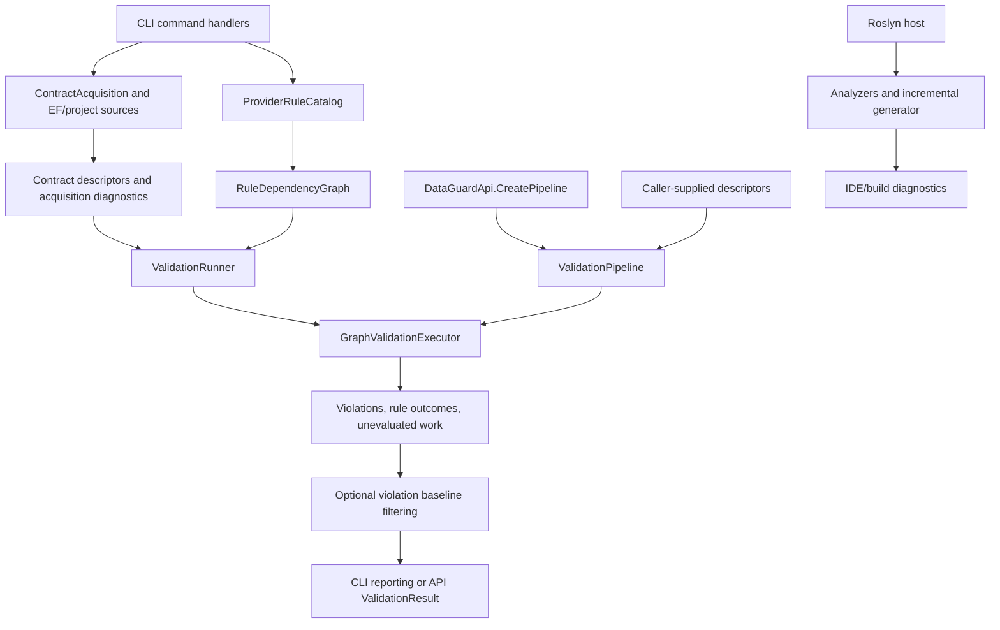
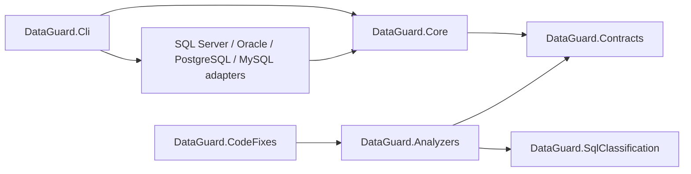

# Kiến Trúc StackAccord / StackAccord Architecture

## Tổng Quan / Overview

StackAccord includes a CLI, Roslyn analyzers/generator, library APIs and editor integrations for .NET database contracts. SQL Server, Oracle, PostgreSQL and MySQL have distinct adapters; support for one operation does not imply identical grammar or metadata coverage across providers.

StackAccord gồm CLI, Roslyn analyzer/generator, API thư viện và tích hợp editor cho contract cơ sở dữ liệu .NET. Bốn adapter có phạm vi riêng; không suy ra parity về grammar hay metadata.

This document describes source wiring reviewed on 2026-10-18, not a runtime verification or published-release claim. The earlier document carried the historical date 2025-01-19; its illustrative diagrams and version pins were not current implementation evidence.

## Kiến Trúc Cấp Cao / High-Level Architecture

The CLI does not construct the public `ValidationPipeline`; both paths share `GraphValidationExecutor`. The public pipeline does not acquire a database schema or emit CLI reports on behalf of its caller. See [CLI validation](../src/DataGuard.Cli/Commands/ValidateCommand.cs), [ValidationRunner](../src/DataGuard.Cli/Services/ValidationRunner.cs) and [public API](../src/DataGuard.Core/PublicApi/PublicApiSurface.cs).

CLI và API dùng chung executor nhưng có orchestration riêng. Caller của API phải cung cấp descriptors; pipeline không tự trích xuất schema hay xuất báo cáo CLI.

## Đồ Thị Phụ Thuộc Module / Module Dependency Graph

Arrows mean “references / tham chiếu”, not execution order.

Core has EF Core, Roslyn, configuration and security dependencies, but database drivers and SQL Server ScriptDOM live in adapters. “No database-driver dependency” does not mean dependency-free. Project references and package versions are authoritative in each `src/*/*.csproj`, not a duplicated version table.

## Lớp IDE và Build / IDE and Build Layer

[UnvalidatedSqlCallGenerator](../src/DataGuard.Analyzers/UnvalidatedSqlCallGenerator.cs) uses incremental syntax classification for DG001 without database I/O. Roslyn diagnostic analyzers can also run in IDE/build hosts; they are not a CI-only copy of the CLI pipeline. Code actions are offered only for supported diagnostics/context, and applying one is not proof of a valid database contract.

Generator phân loại cú pháp không truy cập DB. Analyzer có thể chạy trong IDE và build; sửa nhanh vẫn cần được đánh giá lại.

## Thực Thi Quy Tắc / Rule Execution

[RuleDependencyGraph](../src/DataGuard.Core/Rules/RuleDependencyGraph.cs) provides execution order and parallel groups. The current built-in dependency edges are DG003→DG101, DG004→DG101, DG005→DG002, DG006→DG004/DG101 (arrow means “depends on”). Edges are applied only when both rules are present. Provider catalog composition and plugins determine the actual rule set; there is no fixed six-rule or fourteen-rule pipeline.

[GraphValidationExecutor](../src/DataGuard.Core/Validation/ConcurrentValidationEngine.cs) runs sequentially or by dependency level. Concurrent execution uses bounded batches with `Parallel.ForEachAsync`; it reports rule failures, dropped findings and unevaluated contracts. Missing grammar, Unknown type mappings and failed metadata acquisition must not be read as successful validation.

Không có cam kết độ trễ từ sơ đồ này; thời gian phụ thuộc nguồn, số contract, rule và môi trường. Không bỏ qua trạng thái incomplete/unevaluated khi đọc kết quả.

## Adapter và Ground Truth / Adapters and Ground Truth

[ContractAcquisition](../src/DataGuard.Cli/Services/ContractAcquisition.cs) selects snapshot, manual assembly or provider catalog sources according to configuration and connection availability. EF ModelSnapshot input is C# source parsed by `ModelSnapshotCSharpParser`, not JSON or arbitrary execution of `BuildModel`.

See the source-reviewed guides for [SQL Server](03-components/adapters/sqlserver-adapter.md), [Oracle](03-components/adapters/oracle-adapter.md), [PostgreSQL](03-components/adapters/postgresql-adapter.md) and [MySQL](03-components/adapters/mysql-adapter.md). Oracle REF CURSOR description can execute eligible subprograms only through the explicit `Oracle.DescribeRefCursors` opt-in; ordinary catalog extraction does not imply procedure execution.

## Baseline và Snapshot / Baselines and Snapshots

A violation baseline suppresses previously recorded findings. A current schema snapshot is format v4 and carries tables, procedures and a `canonical-schema-v2` integrity hash. These are different purposes even though [BaselineManager](../src/DataGuard.Core/Baseline/BaselineManager.cs) supports both. A violation-set hash is not evidence of structural database drift. `snapshot refresh` explicitly writes a snapshot; ordinary live validation does not promise automatic refresh.

Baseline lọc finding cũ; snapshot lưu ground truth schema. Snapshot hợp lệ chỉ chứng minh dữ liệu snapshot nhất quán, không chứng minh database hiện tại chưa thay đổi.

## Bảo Mật, Plugin và Telemetry / Security, Plugins and Telemetry

- [Credential resolution](../src/DataGuard.Core/Security/ZeroTrustCredentialProvider.cs) tries configured sources in order: environment, Azure Key Vault, host-registered stores (AWS in the CLI), HashiCorp Vault, local protected storage, then explicitly permitted plaintext fallback. It is not an unconditional call to every service.
- [Plugin admission](../src/DataGuard.Core/Plugins/PluginAdmission.cs) precedes loading; manifest, digest, dependency and provenance checks matter. MEF export discovery alone does not establish trust.
- [SupplyChainVerifier](../src/DataGuard.Core/Security/SupplyChainVerifier.cs) performs its configured integrity checks; it is not a substitute for hosted signing/provenance verification.
- Telemetry is opt-in. See [telemetry](03-components/core/telemetry.md) and [security](03-components/core/security.md) for current configuration boundaries.

## Health Host

Core health probes are transport-neutral. [DataGuard.Host](../src/DataGuard.Host/Program.cs) is a separate opt-in loopback host: `EnableHost` enables the process and `ExposeEndpoints` enables routes. Its local probes cover configured snapshot/baseline readability, disk and managed memory; they do not connect to databases or verify credentials. `/health/startup` and `/health/ready` use cached probe state, not a hard-coded 30-second startup rule. CLI/library use does not automatically expose HTTP endpoints.

Host HTTP phải bật tường minh; readiness không chứng minh database hay credential sử dụng được. Xem [health guide](03-components/core/health.md).

## Build, Deployment và Versioning

[Solution overview](SOLUTION.md) lists current build surfaces. [Release workflow](../.github/workflows/release.yml) defines package/image publication, guards and dry-run behavior. Workflow presence does not prove a release occurred. Marketplace publication remains paused under the maintained [publishing guide](marketplace-publishing.md).

`DataGuardApi.Version = "1.0.0"` is an API-surface constant, not the currently published product version. Build/package versioning comes from project/build metadata, MinVer and explicit workflow version inputs.

## Ma Trận License / License Matrix

| Package / Gói | License / Giấy Phép | Vendor Deps / Phụ Thuộc Vendor |
|---------|---------|-------------|
| DataGuard.Contracts | MIT | None |
| DataGuard.Core | GPL-3.0-only | EF Core, Roslyn and supporting packages; no database driver |
| DataGuard.SqlServer.Adapter | GPL-3.0-only | ScriptDOM (MIT) |
| DataGuard.Oracle.Adapter | GPL-3.0-only + Oracle License | Oracle.ManagedDataAccess.Core |
| DataGuard.Analyzers | GPL-3.0-only | Roslyn (MIT) |
| DataGuard.Cli | GPL-3.0-only | Core + Adapters |

License identities above are retained; consult [LICENSE](../LICENSE) and [third-party notices](legal/THIRD-PARTY-NOTICES.md) for authoritative terms. No license or product identity change is implied by this source reconciliation.
