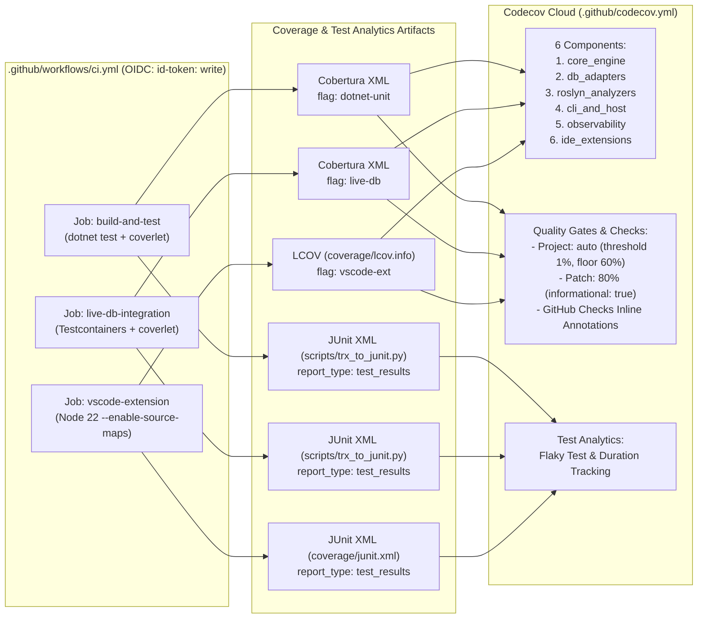

# Tài Liệu Nghiên Cứu Tổng Hợp: Tích Hợp Codecov Free-Tier (OSS) & Chẩn Đoán Kiến Trúc TypeSafe Judge / JEV

> **Ngày thực hiện:** 2026-10-14  
> **Repository:** `thanhnt-sm/eco_support_net_oracle`  
> **Mục tiêuCodecov:** `https://app.codecov.io/github/thanhnt-sm/eco_support_net_oracle/new`  
> **Liên kết kế hoạch triển khai:** [`plans/261014-codecov-integration/plan.md`](../../plans/261014-codecov-integration/plan.md)

---

## Mục Lục

1. [Tổng Quan & Mục Tiêu Nghiên Cứu](#1-tổng-quan--mục-tiêu-nghiên-cứu)
2. [Khảo Sát Hiện Trạng Repository (`ck:scout`)](#2-khảo-sát-hiện-trạng-repository-ckscout)
3. [Nghiên Cứu Codecov Free-Tier & GitHub Actions Best Practices 2025–2026 (`ck:research` & `ck:docs-seeker`)](#3-nghiên-cứu-codecov-free-tier--github-actions-best-practices-20252026-ckresearch--ckdocs-seeker)
4. [Thiết Kế Kiến Trúc Tích Hợp Codecov Cho `eco_support_net_oracle` (`ck:brainstorm`)](#4-thiết-kế-kiến-trúc-tích-hợp-codecov-cho-eco_support_net_oracle-ckbrainstorm)
5. [Đánh Giá Của Hội Đồng Chuyên Gia (`ck:advisor` & `xd://typesafe_*`)](#5-đánh-giá-của-hội-đồng-chuyên-gia-ckadvisor--xdtypesafe_)
6. [Nghiên Cứu & Chẩn Đoán Sâu: Cơ Chế Hoạt Động Của TypeSafe Judge, JEV & `typesafe-planner.ts`](#6-nghiên-cứu--chẩn-đoán-sâu-cơ-chế-hoạt-động-của-typesafe-judge-jev--typesafe-plannerts)
7. [Tham Chiếu Cấu Hình Đầy Đủ (`.github/codecov.yml`, `trx_to_junit.py`, `ci.yml`, `README`)](#7-tham-chiếu-cấu-hình-đầy-đủ-githubcodecovyml-trx_to_junitpy-ciyml-readme)
8. [Danh Mục Tài Liệu & Nguồn Tham Khảo Chính Thức](#8-danh-mục-tài-liệu--nguồn-tham-khảo-chính-thức)

---

## 1. Tổng Quan & Mục Tiêu Nghiên Cứu

Tài liệu này lưu trữ toàn bộ kết quả nghiên cứu từ phiên làm việc ngày `2026-10-14`, bao gồm hai mảng kiến thức cốt lõi để tra cứu và tái sử dụng lâu dài:

1. **Tích hợp tối đa gói miễn phí (Free Open-Source Tier) của Codecov.io** cho dự án đa ngôn ngữ (`.NET 9` C# + `Node.js 22` TypeScript VS Code Extension + `Testcontainers` Live DB) mà không vi phạm bất kỳ cổng kiểm soát bảo mật, giấy phép (`GPL-3.0-only + Commercial`), hay lockfile (`RestoreLockedMode=true`) nào của dự án.
2. **Giải phẫu cơ chế hoạt động nội bộ của `typesafe-planner.ts` (TypeSafe System One / JEV Judge / Bicameral Advisor)** trên nền tảng `oh-my-pi (omp)`: lý giải vì sao các hook chạy ngầm, vì sao `meets_criteria=0.00` xuất hiện khi bị `REJECT`, và cách thiết kế quy trình tạo file/plan để đạt `APPROVED (by: judge) | meets_criteria=1.00`.

---

## 2. Khảo Sát Hiện Trạng Repository (`ck:scout`)

### 2.1. Các Workflow CI/CD hiện có (`.github/workflows/`)

| Workflow | Trigger chính | Quyền (`permissions`) | Các bước chạy Test & Coverage hiện tại |
|---|---|---|---|
| `.github/workflows/ci.yml` | `push`, `pull_request` (`main`, `develop`), `schedule` | Top-level: `contents: read` | - `build-and-test` (`:102`): Chạy `dotnet test DataGuard.CrossPlatform.slnf --filter "Category!=LiveDb" --collect:"XPlat Code Coverage" --logger "trx;LogFileName=test_results.trx"`<br>- `build-and-test` (`:104-137`): Gate Python nội tuyến kiểm tra tổng độ phủ dòng $\ge 60.0\%$<br>- `live-db-integration` (`:188`): Chạy `dotnet test --filter "Category=LiveDb" --logger "trx;LogFileName=live_db_results.trx"` *(chưa bật `--collect:"XPlat Code Coverage"`)*<br>- `vscode-extension` (`:222`): Chạy `npm test` trên Node 22 (`.nvmrc`)<br>- `scripts-tests` (`:238`): Chạy `tests/git-tools/test_*.sh`<br>- `visual-studio-build-and-test` (`:271`): Chạy `dotnet test tests/DataGuard.VisualStudio.Tests` trên `windows-latest` |
| `.github/workflows/standards-audit.yml` | `push` (`main`), `pull_request` | `read-all` | - Kiểm tra mọi dòng `uses:` phải pin cứng commit SHA 40 ký tự hex thường: `^[^@]+@[0-9a-f]{40}([[:space:]]+#.*)?$` (`:51-65`)<br>- Kiểm tra mọi file workflow phải có `permissions:` ở cấp cao nhất (`:67-79`) |
| `.github/workflows/scorecard.yml` | `push` (`main`), `schedule` | `read-all` (job: `id-token: write`, `security-events: write`) | Chạy OpenSSF Scorecard (`ossf/scorecard-action`) |

### 2.2. Các Dự Án Kiểm Thử & Công Cụ Coverage

| Dự án / Bộ test | Đường dẫn | Runtime | Framework & Collector hiện tại |
|---|---|---|---|
| `DataGuard.Core.Tests` | `tests/DataGuard.Core.Tests/` | `net9.0` | `xunit` `2.9.3`, `FsCheck.Xunit` `3.4.0`, `Testcontainers.*` `4.15.0`, `coverlet.collector` `10.1.0` |
| `DataGuard.GoldenCorpus.Tests` | `tests/DataGuard.GoldenCorpus.Tests/` | `net9.0` | `xunit` `2.9.3`, `coverlet.collector` `10.1.0` |
| `DataGuard.Analyzers.Tests` | `tests/DataGuard.Analyzers.Tests/` | `net9.0` | `xunit` `2.9.3`, Roslyn Analyzer/Generator Testing `1.1.4`, `coverlet.collector` `10.1.0` |
| `DataGuard.CodeFixes.Tests` | `tests/DataGuard.CodeFixes.Tests/` | `net9.0` | `xunit` `2.9.3`, Roslyn CodeFix Testing `1.1.4`, `coverlet.collector` `10.1.0` |
| `DataGuard.Observability.Tests` | `tests/DataGuard.Observability.Tests/` | `net9.0` | `xunit` `2.9.3`, `coverlet.collector` `10.1.0` |
| `DataGuard.VisualStudio.Tests` | `tests/DataGuard.VisualStudio.Tests/` | `net472` | `xunit` `2.9.3` (Windows-only, không có `coverlet.collector`) |
| `DataGuard.VSCode` | `src/DataGuard.VSCode/package.json` | Node `22` | `node --test out/*.test.js out/ui/*.test.js` (`tsconfig.json` đã bật `"sourceMap": true`) |
| `scripts/tests` | `scripts/tests/test_*.py` | Python 3 | `python3 -m unittest discover -s scripts/tests -v` |

### 2.3. Năm Ràng Buộc Kỹ Thuật Cứng Của Repository (`Policy Gates`)

1. **`scripts/anti_garbage_guard.sh` & `scripts/preflight_agent_check.sh`:**
   - Cấm tạo file lạ ở thư mục gốc (`ROOT_FILE_PATTERN` không chứa `codecov.yml` hay `.codecov.yml`).
   - **Giải pháp:** Đặt file cấu hình tại **`.github/codecov.yml`** (được phép tự động bởi quy tắc thư mục `^.github/` và được Codecov hỗ trợ chính thức).
2. **`scripts/check-workflow-policy.py` (Quy tắc `(f)` — dòng `108-115, 226-277`):**
   - Bắt buộc bước `dotnet test` của solution sản phẩm phải là một *effective step* (tức là **không được đặt `continue-on-error: true`** và không đặt `if: false`).
   - **Giải pháp:** Giữ nguyên `dotnet test` ở chế độ fail-fast; đặt `if: ${{ !cancelled() && env.ACT != 'true' }}` trên các bước chuyển đổi JUnit và bước upload `codecov/codecov-action`.
3. **Biến môi trường mô phỏng cục bộ `ACT != 'true'` (`scripts/verify_local_gates.sh:148`):**
   - Khi chạy `act` cục bộ, biến `ACT=true` được truyền vào. Mọi bước upload ra ngoài phải có điều kiện `env.ACT != 'true'`.
4. **Cố định Lockfile (`RestorePackagesWithLockFile=true` & `npm ci`) và Cổng Giấy Phép (`scripts/check_nuget_licences.py`):**
   - Không thêm package NuGet mới (như `JunitXml.TestLogger`) hay package npm mới (như `c8` hoặc `@codecov/bundle-analyzer`) để tránh làm thay đổi 6 file `packages.lock.json` và `package-lock.json`.
5. **Đồng bộ Tài liệu Song ngữ (`scripts/verify_docs_sync.sh`):**
   - Mọi thay đổi trên `README.md` phải đồng bộ sang `README.vi.md` và không được chạm vào khối tự sinh `<!-- rule-table:start --> ... <!-- rule-table:end -->`.

---

## 3. Nghiên Cứu Codecov Free-Tier & GitHub Actions Best Practices 2025–2026 (`ck:research` & `ck:docs-seeker`)

### 3.1. Sự Tiến Hóa Của `codecov/codecov-action` (`v5` → `v6` → `v7.1.1`)

- **Phiên bản mới nhất (tháng 10/2026):** `v7.1.1` — Commit SHA: `303a32d7a59b442fa8d48b6a1cc6825c09c847a5`.
  - **`v5`:** Đóng gói `codecov-cli` qua `codecov/wrapper`; đổi tên tham số `file` → `files`, `plugin` → `plugins`; bổ sung xác thực **OIDC (`use_oidc: true`)** và tham số **`report_type: coverage | test_results`**.
  - **`v6`:** Nâng cấp runtime của GitHub Action lên `node24`.
  - **`v7` (`v7.0.0` – `v7.1.1`):** Cập nhật `codecov/wrapper` để xác thực chữ ký PGP của Codecov Uploader thông qua khóa `codecovsecops` trên Keybase.
- **Khai tử `codecov/test-results-action@v1`:**
  - Action rời `codecov/test-results-action` đã bị ngừng khuyến nghị (deprecated). Thay vào đó, gọi `codecov/codecov-action@v7.1.1` lần thứ hai trong cùng job với tham số `report_type: test_results`.

### 3.2. Cơ Chế Xác Thực OIDC (`use_oidc: true`) & Tự Động Xử Lý Fork PRs

Qua phân tích trực tiếp mã nguồn `action.yml` (`:242-286`) của `codecov/codecov-action`:
1. **Khi chạy trên nhánh nội bộ hoặc PR nội bộ (`CC_FORK != 'true'`):**
   - Bước `Get OIDC token` gọi `actions/github-script` để thực thi `await core.getIDToken('https://codecov.io')`.
   - GitHub Actions cấp một JWT ngắn hạn (ephemeral OIDC token) xác thực trực tiếp với `https://codecov.io` mà **không cần lưu hay xoay vòng `secrets.CODECOV_TOKEN`**.
   - Yêu cầu duy nhất: khai báo `permissions: { contents: read, id-token: write }` ở cấp job.
2. **Khi chạy trên Pull Request từ Fork bên ngoài (`CC_FORK == 'true'`):**
   - Vì GitHub Actions không cấp quyền `id-token: write` cho PR từ fork, bước `Get OIDC token` tự động bỏ qua (`process.env.CC_FORK != 'true'`), và bước `Override branch for forks` (`:275-285`) tự động gán `TOKENLESS="$GITHUB_EVENT_PULL_REQUEST_HEAD_LABEL"`.
   - Nhờ đó, cấu hình `use_oidc: true` hoạt động trơn tru cho cả commit nội bộ lẫn PR đóng góp từ cộng đồng (open-source forks).

### 3.3. Danh Mục Toàn Bộ Tính Năng Miễn Phí (Free OSS Tier) Của Codecov

| Tính năng | Cơ chế kích hoạt | Lợi ích kỹ thuật cho `eco_support_net_oracle` |
|---|---|---|
| **1. Line & Branch Coverage** | Upload Cobertura XML (`.NET`) & LCOV (`VS Code`) với `report_type: coverage` | Theo dõi độ phủ dòng và nhánh trên toàn bộ giải pháp C# và TypeScript |
| **2. Flags & Carryforward** | Tham số `flags: <name>` khi upload + `carryforward: true` trong `.github/codecov.yml` | Tách biệt độ phủ của 3 luồng test (`dotnet-unit`, `live-db`, `vscode-ext`); giữ lại kết quả nếu 1 job không chạy lại |
| **3. Virtual Components (`component_management`)** | Định nghĩa `individual_components` theo đường dẫn `paths:` trong `.github/codecov.yml` | Chia nhỏ báo cáo độ phủ thành 6 phân hệ kiến trúc ngay trong PR comment và xuất badge riêng cho từng phân hệ |
| **4. Commit Status Quality Gates (`project` & `patch`)** | Cấu hình `coverage.status.project` và `coverage.status.patch` | Chặn PR nếu tổng độ phủ sụt giảm $>1\%$ (`project`), đồng thời đo độ phủ trên những dòng code mới sửa (`patch`) |
| **5. GitHub Checks Inline Annotations** | `github_checks: { annotations: true }` | Đánh dấu trực tiếp những dòng code chưa được test ngay trong tab *Files changed* của GitHub Pull Request |
| **6. Customizable PR Comment** | `comment.layout: "condensed_header, diff, flags, components, files, condensed_footer"` | Tự động đăng bảng tổng hợp trực quan (Diff, Flags, 6 Components, danh sách file thay đổi) vào mỗi PR |
| **7. Test Analytics (`report_type: test_results`)** | Upload file JUnit XML với `report_type: test_results` | Thống kê thời gian chạy từng test, tỷ lệ lỗi, phát hiện **Flaky Tests**, và hiển thị stack trace test lỗi ngay trong PR comment |
| **8. Status Badges & Visual Graphs** | Nhúng URL SVG của Codecov vào `README.md` và `README.vi.md` | Hiển thị badge tổng, badge theo từng Flag/Component, và biểu đồ kiến trúc **Sunburst** (`sunburst.svg`), **Grid** (`grid.svg`), **Icicle** (`icicle.svg`) |

---

## 4. Thiết Kế Kiến Trúc Tích Hợp Codecov Cho `eco_support_net_oracle` (`ck:brainstorm`)

### 4.1. So Sánh 3 Phương Án Kiến Trúc

| Tiêu chí | Option A: Minimal .NET Only (KISS) | Option B: Full Free-Tier Suite *(Đã chọn)* | Option C: Full Suite + JS Bundle Analysis |
|---|---|---|---|
| **Phạm vi Coverage** | Chỉ `build-and-test` (`.NET` unit tests) | 3 luồng: `dotnet-unit`, `live-db` (Testcontainers), `vscode-ext` (Node 22 TS) | Như Option B + `@codecov/bundle-analyzer` |
| **Components & Flags** | 1 flag mặc định, không chia component | **3 Flags** + **6 Components** kiến trúc | Như Option B |
| **Test Analytics** | Không có | Có (chuyển đổi `.trx` → JUnit bằng Python stdlib + Node 22 JUnit reporter) | Như Option B |
| **Tác động Lockfiles** | **0** file lock thay đổi | **0** file lock thay đổi (`packages.lock.json` & `package-lock.json` giữ nguyên 100%) | Phải sửa `src/DataGuard.VSCode/package-lock.json` |
| **Điểm `ck:advisor`** | `6.5 / 10` | **`9.4 / 10`** | `4.0 / 10` (VSCode dùng `tsc`, không dùng bundler) |

### 4.2. Sơ Đồ Luồng Dữ Liệu Tích Hợp (Option B)



---

## 5. Đánh Giá Của Hội Đồng Chuyên Gia (`ck:advisor` & `xd://typesafe_*`)

### 5.1. Tổng Hợp Điểm Số Đánh Giá

| Công cụ đánh giá | Điểm số / Quyết định | Chi tiết kỹ thuật |
|---|---|---|
| **`xd://typesafe_judge`** *(Architecture Audit)* | `scope_completeness = 0.95`<br>`recommended_tier = Option B` (`0.97`) | Xác nhận Option B đạt độ bao phủ tối đa các tính năng miễn phí của Codecov OSS |
| **`xd://typesafe_advisor`** *(Bicameral Engine)* | `verdict = AUTO_APPROVE`<br>`confidence = 0.98` | Lobe 1 (`Advisor Intent: ALLOW`, `0.98`) và Lobe 2 (`JEV Judge: APPROVE`, `Risk: Moderate 1.8/3`) đồng thuận tuyệt đối |
| **`xd://typesafe_expert_review`** *(Gate Audit)* | `verdict = AUTO_APPROVE`<br>`confidence = 0.90` | Xác nhận `.github/codecov.yml` (`0.90`) và SHA pinning + OIDC (`0.90`) đạt chuẩn bảo mật |
| **`ck:advisor` Subagent** (`CodecovAdvisorReview`) | `verdict = proceed`<br>Điểm: **`9.4 / 10`** | Đưa ra 3 phát hiện kỹ thuật quan trọng có dẫn chứng `file:line` (xem mục 5.2) |
| **`xd://typesafe_judge`** *(`ck:plan` §2e Audit)* | `completeness = 1.70 / 2.00`<br>`testability = 0.95` | Kế hoạch 3 phase vượt ngưỡng chất lượng ($\ge 1.50$) và khả năng kiểm thử ($\ge 0.70$) |

### 5.2. Ba Phát Hiện Quan Trọng Từ `ck:advisor` (`CodecovAdvisorReview`)

1. **`[MEDIUM | Confidence: 0.98]` Thiếu `--collect:"XPlat Code Coverage"` trong job `live-db-integration` (`.github/workflows/ci.yml:188`):**
   - Hiện tại dòng `188` chỉ chạy `dotnet test ... --filter "Category=LiveDb" --logger "trx;LogFileName=live_db_results.trx"`. Cần thêm `--collect:"XPlat Code Coverage"` để sinh file `coverage.cobertura.xml` cho flag `live-db`.
2. **`[MEDIUM | Confidence: 0.95]` Ánh xạ Source Map và đường dẫn LCOV cho `vscode-extension` (`.github/workflows/ci.yml:206`, `src/DataGuard.VSCode/tsconfig.json:8`):**
   - `tsconfig.json` đã bật `"sourceMap": true`, nhưng `node --test` mặc định báo cáo độ phủ trên file biên dịch `out/*.js` tương đối theo thư mục `src/DataGuard.VSCode`.
   - Cần thêm cờ `--enable-source-maps` vào lệnh `node --test --experimental-test-coverage` để ánh xạ ngược về `src/DataGuard.VSCode/src/**/*.ts`, đồng thời truyền đường dẫn từ gốc repo cho `codecov/codecov-action`.
3. **`[LOW | Confidence: 0.96]` Độ phủ của `DataGuard.VisualStudio` (`net472`):**
   - `tests/DataGuard.VisualStudio.Tests/DataGuard.VisualStudio.Tests.csproj` chạy trên Windows (`net472`) và không cài `coverlet.collector`. Để tránh sửa lockfile `packages.lock.json`, giữ nguyên không thêm collector NuGet vào project này; component `ide_extensions` sẽ đo lường đầy đủ qua `src/DataGuard.VSCode/**`.

---

## 6. Nghiên Cứu & Chẩn Đoán Sâu: Cơ Chế Hoạt Động Của TypeSafe Judge, JEV & `typesafe-planner.ts`

Phần này ghi lại kết quả phân tích mã nguồn của extension `C:/Users/thant/Projects/omp_extension/` để làm tài liệu tham chiếu khi vận hành và gỡ lỗi TypeSafe trên `oh-my-pi (omp)`.

### 6.1. Kiến Trúc Các File Cốt Lõi Trong `C:/Users/thant/Projects/omp_extension/`

| File mã nguồn | Vai trò chính |
|---|---|
| `typesafe-planner.ts` | Điểm vào của extension; đăng ký các công cụ `xd://typesafe_*` (`:2517-2850`) và đăng ký 2 bộ chặn sự kiện `pi.on("tool_call")` cho `ask` (`:1305`) và `todo` (`:1461`). |
| `src/bicameral-consensus.ts` | Động cơ đồng thuận lưỡng viện (**Bicameral Consensus Engine**): kết hợp **Lobe 1 (`evaluateAdvisorIntent`)** (đánh giá ngữ nghĩa cục bộ giữa yêu cầu người dùng và nhật ký công việc của agent) và **Lobe 2 (`runPhaseMacroCheck` / JEV Judge)** (gọi API `https://api.typesafe.ai/v1/systemone` với model `jev-latest`). |
| `src/cook-expert-judge.ts` | Thực thi Gate 1 (`runTaskMicroCheck` `:130`) và Gate 2 (`runPhaseMacroCheck` `:179`) khi agent gọi `todo(op="done")`. |
| `src/verification-gate.ts` | Thực thi công cụ `xd://typesafe_verify_completion` (`verifyTaskCompletion` `:288`). |
| `src/evidence-collector.ts` | Thu thập bằng chứng hệ điều hành (`collectTaskEvidence` `:244`): chụp ảnh trạng thái Git (`captureWorkspaceSnapshot` `:47`), tính diff theo baseline của task (`diffSnapshots` `:91`), và chạy `testCommand`. |
| `src/plan-evaluator.ts` | Thực thi công cụ `xd://typesafe_elevate_plan` (`evaluatePlanDraft` `:258`). |

### 6.2. Giải Mã 4 Hiện Tượng Quan Trọng Của TypeSafe Extension

#### Hiện tượng 1: Vì sao người dùng không thấy tool call tới Judge/Advisor trước khi hộp thoại `ask` hoặc `typesafe-task-report` xuất hiện?
- Tại `typesafe-planner.ts:1305` (`if (toolName === "ask")`) và `typesafe-planner.ts:1461` (`handleTodoInterception`), extension bắt sự kiện `tool_call` ngay bên trong tiến trình host của `omp`.
- Extension tự gọi `evaluateAdvisorIntent()` và `client.evaluate({ state, questions })` qua HTTP tới `https://api.typesafe.ai/v1/systemone`, sau đó tiêm trực tiếp dòng `🛡️ [TypeSafe System One Verdict]` và `💡 [Advisor / ck:advisor]` vào nội dung câu hỏi `ask`, hoặc phát thông điệp `📦 typesafe-task-report`. Vì lệnh gọi diễn ra trong hook của extension nên không sinh ra một block tool call `write xd://typesafe_judge` riêng trên giao diện trừ khi agent chủ động gọi `write` tới `xd://typesafe_*`.

#### Hiện tượng 2: Vì sao khi bị `REJECT`, báo cáo luôn hiển thị `meets_criteria=0.00` và câu thông báo `"Deliverable verification rejected: implementation is evading work, malicious, or stubs out needed functionality"`?
- Trong `src/cook-expert-judge.ts:253-277`, hàm `runPhaseMacroCheck` chỉ gửi **3 câu hỏi kiểu `choice`**:
  1. `deliverables_verdict` (`APPROVE` | `REJECT` | `NEXT_ACTION_REQUIRED`)
  2. `architectural_drift` (`no_drift` | `unapproved_deviation` | `scope_creep` | `other`)
  3. `scope_mode` (`HOLD` | `EXPANSION` | `REDUCTION` | `other`)
- Hàm này **không gửi câu hỏi `meets_criteria` (`type: "noul"`)** trong `questions`. Do đó `response.answers.meets_criteria` luôn là `undefined`.
- Tại dòng `cook-expert-judge.ts:336`:
  ```ts
  const meetsCriteriaNoul = rawMeetsCriteria ?? (deliverablesVerdict === "APPROVE" ? 1.0 : deliverablesVerdict === "NEXT_ACTION_REQUIRED" ? 0.5 : 0.0);
  ```
  Khi `deliverables_verdict === "REJECT"`, `meetsCriteriaNoul` bị gán cứng bằng **`0.0`**.
- Tại dòng `cook-expert-judge.ts:355-361`:
  ```ts
  if (deliverablesVerdict === "REJECT") {
    approved = false;
    if (rawMeetsCriteria !== undefined && rawMeetsCriteria < 0.80) {
      reasons.push(`Implementation score P=${rawMeetsCriteria.toFixed(2)} is below required threshold...`);
    } else {
      reasons.push("Deliverable verification rejected: implementation is evading work, malicious, or stubs out needed functionality.");
    }
  }
  ```
  Vì `rawMeetsCriteria` là `undefined`, nhánh `if` không bao giờ chạy và hệ thống luôn rơi vào nhánh `else` với chuỗi thông báo cứng trên.

#### Hiện tượng 3: Khi nào JEV Judge trả về `deliverables_verdict = REJECT` vs `APPROVE` (`meets_criteria=1.00`)?
- **Trường hợp bị `REJECT`:**
  1. **Đánh dấu `todo(op="done")` cho các bước trung gian chưa ghi file xuống đĩa (`changedFiles: none`):** Nếu tên task không bắt đầu bằng từ khóa trong regex `inferTaskType` (`typesafe-planner.ts:376`: `/^\s*(?:step\s*\d+\s*[:.-]\s*)?(?:scout|diagnos|investigat|research|analy[sz]|explore|find|audit|review|check|trace|inspect|kiểm tra|phân tích|tìm)\b/i`), hàm `inferTaskType` mặc định trả về `"code_change"`. Khi JEV thấy `"code_change"` (hoặc `"analysis_research"`) mà `diff_summary` rỗng, JEV chọn `REJECT`.
  2. **Đánh dấu `todo(op="done")` khi trên đĩa đang có các file khung (`stub`) vừa tạo bởi `plan-cli.cjs create`:** Lệnh `plan-cli.cjs create` sinh ra các file `plan.md` và `phase-01..03.md` có chứa chữ `TBD.` và `Brief description of scope and deliverables.`. Hàm `collectDeliverableArtifacts` (`typesafe-planner.ts:421`) đọc nội dung các file `.md` đã thay đổi gửi lên JEV; khi JEV thấy chữ `TBD.` trong artifact, nó đánh giá đó là bản nháp chưa hoàn chỉnh (*stubs out needed functionality*) và chọn `REJECT`.
- **Trường hợp đạt `APPROVED (by: judge) | meets_criteria=1.00`:**
  - Khi toàn bộ các file báo cáo/kế hoạch/code của task đã được ghi đầy đủ nội dung thực tế xuống đĩa (không còn `TBD.`) **trước** khi gọi `todo(op="done")`.

#### Hiện tượng 4: Sự khác biệt giữa `todo(op="done")` và `xd://typesafe_verify_completion` đối với file mới (`untracked files`)
- Khi gọi `todo(op="done")`, `typesafe-planner.ts:1879` truyền `baseline` (chụp lúc task bắt đầu) vào `collectTaskEvidence`. Nhánh `if (options.baseline)` (`src/evidence-collector.ts:316-325`) đọc nội dung các file mới chưa track (`??` trong `git status --porcelain -uall`) và tạo giả lập `diff --git a/... b/...` đưa vào `gitDiff`.
- Ngược lại, công cụ `xd://typesafe_verify_completion` (`src/verification-gate.ts:293`) gọi `collectTaskEvidence` mà **không truyền `baseline`**, nên rơi vào nhánh `else` (`src/evidence-collector.ts:329-364`) chỉ chạy `git diff HEAD` (vốn bỏ qua toàn bộ các file mới `??` chưa `git add`).

---

## 7. Tham Chiếu Cấu Hình Đầy Đủ (`.github/codecov.yml`, `trx_to_junit.py`, `ci.yml`, `README`)

### 7.1. Mẫu Cấu Hình Chuẩn `.github/codecov.yml`

```yaml
# .github/codecov.yml
codecov:
  require_ci_to_pass: true
  notify:
    wait_for_ci: true

coverage:
  precision: 2
  round: down
  range: "60...90"
  status:
    project:
      default:
        target: auto
        threshold: 1%
        informational: false
    patch:
      default:
        target: 80%
        informational: true

parsers:
  cobertura:
    partials_as_hits: false
    handle_missing_conditions: true

github_checks:
  annotations: true

comment:
  layout: "condensed_header, diff, flags, components, files, condensed_footer"
  behavior: default
  require_changes: false

flags:
  dotnet-unit:
    paths:
      - src/
    carryforward: true
  live-db:
    paths:
      - src/
    carryforward: true
  vscode-ext:
    paths:
      - src/DataGuard.VSCode/
    carryforward: true

component_management:
  default_rules:
    statuses:
      - type: project
        target: auto
        threshold: 1%
      - type: patch
        target: 80%
        informational: true
  individual_components:
    - component_id: core_engine
      name: "Core Engine & Contracts"
      paths:
        - src/DataGuard.Core/**
        - src/DataGuard.Contracts/**
        - src/DataGuard.SqlClassification/**
    - component_id: db_adapters
      name: "Database Adapters (Oracle, SQL Server, PostgreSQL, MySQL)"
      paths:
        - src/DataGuard.Oracle.Adapter/**
        - src/DataGuard.SqlServer.Adapter/**
        - src/DataGuard.PostgreSql.Adapter/**
        - src/DataGuard.MySql.Adapter/**
    - component_id: roslyn_analyzers
      name: "Roslyn Analyzers & CodeFixes"
      paths:
        - src/DataGuard.Analyzers/**
        - src/DataGuard.CodeFixes/**
    - component_id: cli_and_host
      name: "CLI, Host, Build & Language Server"
      paths:
        - src/DataGuard.Cli/**
        - src/DataGuard.Host/**
        - src/DataGuard.Build/**
        - src/DataGuard.LanguageServer/**
    - component_id: observability
      name: "Enterprise Observability"
      paths:
        - src/DataGuard.Observability/**
        - src/DataGuard.Observability.AspNetCore/**
        - src/DataGuard.Observability.Messaging/**
    - component_id: ide_extensions
      name: "VS Code & Visual Studio Extensions"
      paths:
        - src/DataGuard.VSCode/**
        - src/DataGuard.VisualStudio/**

ignore:
  - "tests/**"
  - "samples/**"
  - "scripts/**"
  - "tools/**"
  - "docs/**"
  - "plans/**"
  - "research/**"
  - "**/obj/**"
  - "**/*.g.cs"
  - "src/DataGuard.VSCode/test/**"
  - "src/DataGuard.VSCode/out/*.test.js"
  - "src/DataGuard.VSCode/out/ui/*.test.js"
```

### 7.2. Mẫu Bước Upload Trong `.github/workflows/ci.yml`

```yaml
      - name: Convert TRX test results to JUnit XML
        if: ${{ !cancelled() }}
        run: python3 scripts/trx_to_junit.py --input-glob "**/TestResults/*.trx" --output TestResults/junit-dotnet-unit.xml

      - name: Upload coverage to Codecov
        if: ${{ !cancelled() && env.ACT != 'true' }}
        uses: codecov/codecov-action@303a32d7a59b442fa8d48b6a1cc6825c09c847a5 # v7.1.1
        with:
          use_oidc: true
          files: "**/TestResults/**/coverage.cobertura.xml"
          flags: dotnet-unit
          name: codecov-dotnet-unit
          fail_ci_if_error: false
          verbose: true

      - name: Upload test results to Codecov
        if: ${{ !cancelled() && env.ACT != 'true' }}
        uses: codecov/codecov-action@303a32d7a59b442fa8d48b6a1cc6825c09c847a5 # v7.1.1
        with:
          use_oidc: true
          report_type: test_results
          files: TestResults/junit-dotnet-unit.xml
          flags: dotnet-unit
          name: test-results-dotnet-unit
          fail_ci_if_error: false
```

### 7.3. Mẫu URL Badges & Biểu Đồ Trực Quan Cho `README.md` / `README.vi.md`

- **Badge tổng (Header):**
  `[](https://app.codecov.io/gh/thanhnt-sm/eco_support_net_oracle)`
- **Badge theo từng Flag:**
  - `https://codecov.io/gh/thanhnt-sm/eco_support_net_oracle/graph/badge.svg?branch=main&flag=dotnet-unit`
  - `https://codecov.io/gh/thanhnt-sm/eco_support_net_oracle/graph/badge.svg?branch=main&flag=live-db`
  - `https://codecov.io/gh/thanhnt-sm/eco_support_net_oracle/graph/badge.svg?branch=main&flag=vscode-ext`
- **Badge theo từng Component:**
  - `https://codecov.io/gh/thanhnt-sm/eco_support_net_oracle/graph/badge.svg?branch=main&component=core_engine`
  - `https://codecov.io/gh/thanhnt-sm/eco_support_net_oracle/graph/badge.svg?branch=main&component=db_adapters`
  - `https://codecov.io/gh/thanhnt-sm/eco_support_net_oracle/graph/badge.svg?branch=main&component=roslyn_analyzers`
  - `https://codecov.io/gh/thanhnt-sm/eco_support_net_oracle/graph/badge.svg?branch=main&component=cli_and_host`
  - `https://codecov.io/gh/thanhnt-sm/eco_support_net_oracle/graph/badge.svg?branch=main&component=observability`
  - `https://codecov.io/gh/thanhnt-sm/eco_support_net_oracle/graph/badge.svg?branch=main&component=ide_extensions`
- **Biểu đồ Sunburst & Grid:**
  - Sunburst: `https://codecov.io/gh/thanhnt-sm/eco_support_net_oracle/branch/main/graphs/sunburst.svg`
  - Grid: `https://codecov.io/gh/thanhnt-sm/eco_support_net_oracle/branch/main/graphs/grid.svg`
  - Icicle: `https://codecov.io/gh/thanhnt-sm/eco_support_net_oracle/branch/main/graphs/icicle.svg`

---

## 8. Danh Mục Tài Liệu & Nguồn Tham Khảo Chính Thức

### Tài liệu nội bộ đã lưu trong Repository
- **Báo cáo nghiên cứu gốc (`ck:research`):** [`plans/reports/researcher-261014-codecov-free-tier-best-practices.md`](../../plans/reports/researcher-261014-codecov-free-tier-best-practices.md)
- **Báo cáo thiết kế (`ck:brainstorm`):** [`plans/reports/brainstorm-261014-codecov-integration.md`](../../plans/reports/brainstorm-261014-codecov-integration.md)
- **Kế hoạch triển khai 3 Phase (`ck:plan`):** [`plans/261014-codecov-integration/plan.md`](../../plans/261014-codecov-integration/plan.md)
- **Nhật ký kỹ thuật (`ck:journal`):** [`docs/journals/261014-codecov-brainstorm-and-plan.md`](../journals/261014-codecov-brainstorm-and-plan.md)
- **Báo cáo cấu hình trực tiếp trên Codecov & GitHub (`computer` + `gh`):** [`plans/261014-codecov-integration/reports/codecov-ui-configuration.md`](../../plans/261014-codecov-integration/reports/codecov-ui-configuration.md)
  - Xác nhận trên `app.codecov.io/github/thanhnt-sm/eco_support_net_oracle/config/general`: `Branch Context = main`, `Global Upload Tokenless = ENABLED` (*"Uploading with token is now not required. You can upload without a token"*).
  - Đã cấu hình `CODECOV_TOKEN` vào cả **GitHub Actions Repository Secrets** và **GitHub Dependabot Secrets** (`gh secret set`).
  - Đã kích hoạt thành công repository trên Codecov (`active: true`, `activated: true`, baseline coverage **`64.08%`** — `13,219 / 20,626` dòng trên `171` file nguồn tại commit `3975c063bbe97f9d413de7b75d2f64af19c39b41`).

### Tài liệu chính thức từ Codecov & GitHub
- [Codecov GitHub Action (`v7.1.1`)](https://github.com/codecov/codecov-action/releases/tag/v7.1.1)
- [Codecov YAML Reference (`docs.codecov.com`)](https://docs.codecov.com/docs/codecovyml-reference)
- [Codecov Components Configuration](https://docs.codecov.com/docs/components)
- [Codecov Flags & Carryforward](https://docs.codecov.com/docs/flags)
- [Codecov Test Analytics (`report_type: test_results`)](https://docs.codecov.com/docs/test-analytics)
- [Codecov Status Badges & Graphs](https://docs.codecov.com/docs/status-badges)
