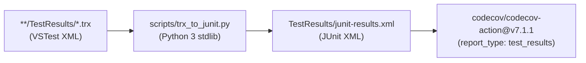

# Phase 1: Codecov Config and TRX-to-JUnit Converter

## Overview
Create `.github/codecov.yml` with full free-tier configuration (Flags, Carryforward, 6 Components, Project/Patch Statuses, GitHub Checks Annotations, PR Comment layout, Ignore rules) and implement `scripts/trx_to_junit.py` + `scripts/tests/test_trx_to_junit.py` for zero-dependency .NET Test Analytics.

## Requirements
- **Functional**:
  - Define `.github/codecov.yml` with:
    - `coverage.status.project.default`: `target: auto`, `threshold: 1%`, `informational: false`.
    - `coverage.status.patch.default`: `target: 80%`, `informational: true`.
    - `github_checks.annotations: true`.
    - `comment.layout: "condensed_header, diff, flags, components, files, condensed_footer"`.
    - `flags`: `dotnet-unit`, `live-db`, `vscode-ext` with `carryforward: true`.
    - `component_management.individual_components`: `core_engine`, `db_adapters`, `roslyn_analyzers`, `cli_and_host`, `observability`, `ide_extensions`.
  - Implement `scripts/trx_to_junit.py` using Python 3 stdlib (`xml.etree.ElementTree`, `glob`, `pathlib`) to parse VSTest `.trx` XML files (`UnitTestResult`, `Output/ErrorInfo/Message`, `StackTrace`, duration `HH:MM:SS.fffffff`) and emit valid JUnit XML (`<testsuites>`, `<testsuite>`, `<testcase>`, `<failure>`, `<skipped>`).
  - Add unit tests in `scripts/tests/test_trx_to_junit.py` covering passed, failed, skipped, and multiple `.trx` inputs.
- **Non-functional**:
  - Zero third-party Python or NuGet dependencies (`packages.lock.json` untouched).
  - `.github/codecov.yml` placed under `.github/` so `scripts/anti_garbage_guard.sh` and `scripts/preflight_agent_check.sh` pass without root-allowlist modifications.

## Architecture

## Related Code Files
- Create: `.github/codecov.yml`
- Create: `scripts/trx_to_junit.py`
- Create: `scripts/tests/test_trx_to_junit.py`

## Implementation Steps
1. Create `.github/codecov.yml` configuring `codecov`, `coverage` (`precision: 2`, `round: down`, `range: "60...90"`, `status.project`, `status.patch`), `parsers.cobertura`, `github_checks`, `comment`, `flags` (`dotnet-unit`, `live-db`, `vscode-ext`), `component_management` (6 components matching `src/DataGuard.*`), and `ignore` patterns (`tests/**`, `samples/**`, `scripts/**`, `tools/**`, `docs/**`, `plans/**`, `**/obj/**`, `**/*.g.cs`, `src/DataGuard.VSCode/out/**/*.test.js`).
2. Create `scripts/trx_to_junit.py` that accepts `--input-glob` (default `**/TestResults/*.trx`) and `--output` (default `TestResults/junit-results.xml`), parses VSTest namespace `http://microsoft.com/schemas/VisualStudio/TeamTest/2010`, maps `className` and `testName`, converts `duration` to seconds, and maps `Outcome="Failed"` to `<failure>` and `Outcome="NotExecuted"` to `<skipped>`.
3. Create `scripts/tests/test_trx_to_junit.py` with deterministic fixtures testing passed/failed/skipped test cases, duration parsing, and exit codes.
4. Run `python3 -m unittest discover -s scripts/tests -v` to verify all unit tests pass.

## Success Criteria
- [x] `.github/codecov.yml` is valid YAML (verified via `python3 -c "import yaml; yaml.safe_load(open('.github/codecov.yml'))"`).
- [x] `python3 -m unittest discover -s scripts/tests -v` passes with 0 errors, including `test_trx_to_junit.py`.
- [x] `bash scripts/anti_garbage_guard.sh` passes.

## Risk Assessment
- **Risk**: VSTest `.trx` files use default XML namespace `http://microsoft.com/schemas/VisualStudio/TeamTest/2010`, which can cause naive tag lookups to miss elements.
- **Mitigation**: Strip or match namespaces explicitly in `scripts/trx_to_junit.py` and test with realistic VSTest XML namespaces in `test_trx_to_junit.py`.
