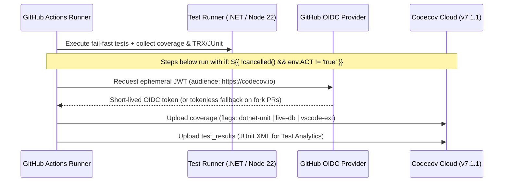

# Phase 2: CI Workflow Multi-Flag and Test Analytics

## Overview
Wire `codecov/codecov-action@303a32d7a59b442fa8d48b6a1cc6825c09c847a5 # v7.1.1` into `.github/workflows/ci.yml` across `build-and-test`, `live-db-integration`, and `vscode-extension` jobs for both coverage (`report_type: coverage`) and Test Analytics (`report_type: test_results`), and add a `test:coverage` script in `src/DataGuard.VSCode/package.json`.

## Requirements
- **Functional**:
  - Pin `codecov/codecov-action@303a32d7a59b442fa8d48b6a1cc6825c09c847a5 # v7.1.1` (40-char lowercase hex commit SHA).
  - Add job-scoped `permissions: { contents: read, id-token: write }` to `build-and-test`, `live-db-integration`, and `vscode-extension` in `.github/workflows/ci.yml`.
  - In `build-and-test`:
    - Convert `**/TestResults/*.trx` to `TestResults/junit-dotnet-unit.xml` via `python3 scripts/trx_to_junit.py` (`if: ${{ !cancelled() }}`).
    - Upload `**/TestResults/**/coverage.cobertura.xml` with `flags: dotnet-unit`, `use_oidc: true`, `fail_ci_if_error: false` (`if: ${{ !cancelled() && env.ACT != 'true' }}`).
    - Upload `TestResults/junit-dotnet-unit.xml` with `report_type: test_results`, `flags: dotnet-unit`, `use_oidc: true`, `fail_ci_if_error: false` (`if: ${{ !cancelled() && env.ACT != 'true' }}`).
  - In `live-db-integration`:
    - Add `--collect:"XPlat Code Coverage"` to the `dotnet test` command (`.github/workflows/ci.yml:188`) so Cobertura XML is generated for live DB adapter tests.
    - Convert `**/TestResults/live_db_results.trx` to `TestResults/junit-live-db.xml` via `python3 scripts/trx_to_junit.py`.
    - Upload coverage (`flags: live-db`) and test results (`report_type: test_results`, `flags: live-db`) via `codecov/codecov-action` (`if: ${{ !cancelled() && env.ACT != 'true' }}`).
  - In `src/DataGuard.VSCode/package.json` & `vscode-extension` job:
    - Add `"test:coverage"` script in `src/DataGuard.VSCode/package.json` using Node 22 native `--enable-source-maps --test --experimental-test-coverage --test-reporter=spec --test-reporter-destination=stdout --test-reporter=lcov --test-reporter-destination=coverage/lcov.info --test-reporter=junit --test-reporter-destination=coverage/junit.xml`.
    - Upload `src/DataGuard.VSCode/coverage/lcov.info` (`flags: vscode-ext`, `working-directory: src/DataGuard.VSCode`) and `src/DataGuard.VSCode/coverage/junit.xml` (`report_type: test_results`, `flags: vscode-ext`) via `codecov/codecov-action` (`if: ${{ !cancelled() && env.ACT != 'true' }}`).
- **Non-functional**:
  - Do NOT add `continue-on-error: true` to any `dotnet test` step (preserving `scripts/check-workflow-policy.py` rule `(f)`).
  - Do NOT modify `src/DataGuard.VSCode/package-lock.json`.

## Architecture

## Related Code Files
- Modify: `.github/workflows/ci.yml`
- Modify: `src/DataGuard.VSCode/package.json`

## Implementation Steps
1. Update `src/DataGuard.VSCode/package.json` to add `"test:coverage"` script that creates `coverage/` dir and runs `node --enable-source-maps --test --experimental-test-coverage` with `spec`, `lcov` (`coverage/lcov.info`), and `junit` (`coverage/junit.xml`) reporters.
2. Update `.github/workflows/ci.yml`:
   - Add `permissions: { contents: read, id-token: write }` to `build-and-test`, `live-db-integration`, and `vscode-extension`.
   - Add TRX→JUnit conversion and 2 `codecov/codecov-action@303a32d7a59b442fa8d48b6a1cc6825c09c847a5 # v7.1.1` steps (`coverage` and `test_results`) in `build-and-test`.
   - Append `--collect:"XPlat Code Coverage"` to `Run live database tests` in `live-db-integration`, plus TRX→JUnit conversion and 2 `codecov/codecov-action` steps (`flags: live-db`).
   - Switch `vscode-extension` unit test step to `npm run test:coverage` and add 2 `codecov/codecov-action` steps (`flags: vscode-ext`, `working-directory: src/DataGuard.VSCode`).
3. Verify workflow policy and SHA pinning with `python3 scripts/check-workflow-policy.py` and the regex check from `.github/workflows/standards-audit.yml`.

## Success Criteria
- [x] `python3 scripts/check-workflow-policy.py` exits 0 (`OK`).
- [x] Every `uses:` line in `.github/workflows/ci.yml` matches `^[^@]+@[0-9a-f]{40}([[:space:]]+#.*)?$`.
- [x] `npm run test:coverage` in `src/DataGuard.VSCode` exits 0 and emits `coverage/lcov.info` and `coverage/junit.xml`.

## Risk Assessment
- **Risk**: `vscode-extension` sets `defaults.run.working-directory: src/DataGuard.VSCode`, which does not apply to `uses:` steps unless `working-directory` is passed in `with:` of `codecov/codecov-action` or paths include `src/DataGuard.VSCode/`.
- **Mitigation**: Explicitly pass `files: src/DataGuard.VSCode/coverage/lcov.info` (and `src/DataGuard.VSCode/coverage/junit.xml`) from repo root so path normalization matches `src/DataGuard.VSCode/**` in `.github/codecov.yml`.
