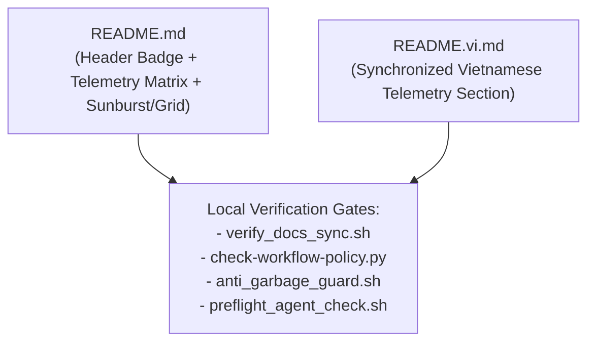

# Phase 3: Bilingual README Telemetry and Gate Verification

## Overview
Update `README.md` and `README.vi.md` with the top-level Codecov badge and a synchronized **Test Coverage & Quality Telemetry** section (Flag badges, 6 Component badges, and interactive Sunburst/Grid SVG graphs), then execute all repository verification gates.

## Requirements
- **Functional**:
  - Add top-level Codecov badge `` to `README.md` (`:3-7`) and `README.vi.md` (`:9-11`).
  - Add a **Test Coverage & Quality Telemetry** (`## Test Coverage & Quality Telemetry` / `## Độ phủ Kiểm thử & Chỉ số Chất lượng`) section to both `README.md` and `README.vi.md` containing:
    - **Test Suite Flags Table**: Live badges for `dotnet-unit`, `live-db`, and `vscode-ext`.
    - **Component Coverage Matrix**: Live badges for `core_engine`, `db_adapters`, `roslyn_analyzers`, `cli_and_host`, `observability`, and `ide_extensions`.
    - **Visual Coverage Architecture Graphs**: Side-by-side Codecov **Sunburst** (`graphs/sunburst.svg`) and **Grid** (`graphs/grid.svg`) SVGs linked to `https://app.codecov.io/gh/thanhnt-sm/eco_support_net_oracle`.
- **Non-functional**:
  - Do not modify generated `<!-- rule-table:start --> ... <!-- rule-table:end -->` blocks in `README.md` or `README.vi.md`.
  - Pass `scripts/verify_docs_sync.sh`, `scripts/anti_garbage_guard.sh`, `scripts/preflight_agent_check.sh`, and `python3 scripts/check-workflow-policy.py`.

## Architecture

## Related Code Files
- Modify: `README.md`
- Modify: `README.vi.md`

## Implementation Steps
1. Edit `README.md` to add the Codecov badge in the top badge block and insert the `## Test Coverage & Quality Telemetry` section before `## Dual licence & FAQ`.
2. Edit `README.vi.md` to add the Codecov badge in the top badge block and insert the matching `## Độ phủ Kiểm thử & Chỉ số Chất lượng` section before `## Giấy phép kép & Câu hỏi thường gặp`.
3. Run full local verification gates:
   - `bash scripts/verify_docs_sync.sh`
   - `bash scripts/anti_garbage_guard.sh`
   - `bash scripts/preflight_agent_check.sh`
   - `python3 scripts/check-workflow-policy.py`
   - `python3 -m unittest discover -s scripts/tests -v`

## Success Criteria
- [x] `bash scripts/verify_docs_sync.sh` passes with 0 errors.
- [x] `bash scripts/preflight_agent_check.sh` outputs `[Pre-Flight OK]`.
- [x] `python3 scripts/check-workflow-policy.py` outputs `OK`.
- [x] `python3 -m unittest discover -s scripts/tests -v` passes all unit tests.

## Risk Assessment
- **Risk**: Accidental edit inside `<!-- rule-table:start -->` could cause `scripts/gen_rule_table.py --check` (`verify_docs_sync.sh`) to fail.
- **Mitigation**: Place the new section strictly after the `<!-- rule-table:end -->` and CLI/Packages sections, and run `bash scripts/verify_docs_sync.sh` immediately.
