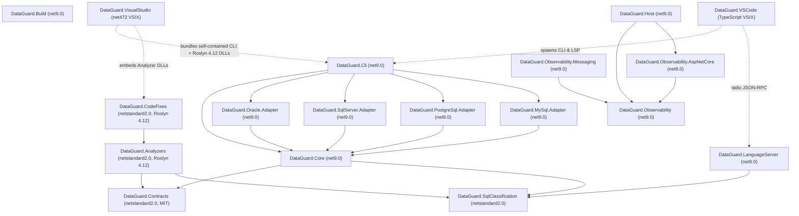

# Baseline Report & Architecture/Dependency Map — `eco_support_net_oracle`

- **Timestamp**: 2026-10-14
- **Commit**: `1e5a5922aeda4116a2198f56fe4ef3dd326330ee`
- **OS / Arch**: Windows 10.0.26200 (`win-x64`)
- **SDKs Installed**:
  - `C:\Users\thant\.dotnet\sdk\9.0.317` (matches `global.json` `9.0.100` with `rollForward: latestFeature`)
  - `C:\Program Files\dotnet\sdk\10.0.401` and `5.0.408` (system `PATH` default; triggers SDK resolution error `155` unless `C:\Users\thant\.dotnet` is prepended to `PATH`)

---

## 1. Baseline Build, Test & Policy Execution Summary

| Check / Suite | Command Executed | Exit Code | Result Summary | Classification |
|---|---|---|---|---|
| Cross-Platform Build | `dotnet build DataGuard.CrossPlatform.slnf -c Release --no-restore` | `0` | 19 projects built, **0 errors, 6 `MSB3277` warnings** in `DataGuard.GoldenCorpus.Tests` | **VERIFIED WARNING DRIFT** |
| Cross-Platform Unit Tests | `dotnet test DataGuard.CrossPlatform.slnf -c Release --no-build --filter "Category!=LiveDb"` (with `.dotnet` first in `PATH`) | `0` | **2,037 / 2,037 passed** (`Core.Tests`: 1,802, `Analyzers.Tests`: 98, `GoldenCorpus.Tests`: 61, `CodeFixes.Tests`: 38, `Observability.Tests`: 38) | **PASS** (3 tests fail if system `.NET 10` is first in `PATH`) |
| Visual Studio Extension Tests | `dotnet test tests/DataGuard.VisualStudio.Tests/DataGuard.VisualStudio.Tests.csproj -c Release --no-build` | `0` | **266 passed, 1 skipped, 0 failed** (`net472`) | **PASS** |
| VS Code Extension Tests | `npm test` (in `src/DataGuard.VSCode`) | `0` | **101 / 101 passed** (`tsc` + `node --test`) | **PASS** |
| Binary Compatibility Gate | `dotnet build tests/DataGuard.BinaryCompatibilityFixture/... -c Release -p:RestoreLockedMode=true` | `1` | **FAILED (`error NU1004`)**: `Microsoft.CodeAnalysis.NetAnalyzers` changed from `[10.0.401, )` to `[10.0.402, )` in `Directory.Build.props`, breaking locked restore on 5 non-`.sln` projects | **VERIFIED P0 CI DEFECT** |
| Python Script Unit Tests | `python3 -m unittest discover -s scripts/tests` | `1` | **111 passed, 6 failed**: 1 failure in `test_alert19_resolution.py:77` (`10.0.13 != 9.0.21`), 5 WSL `bash` relay failures in `test_assert_roslyn_lock.py` on Windows | **VERIFIED P0 CI DEFECT** |
| Workflow Policy Gate | `python3 scripts/check-workflow-policy.py` | `0` | `OK` (5 workflows verified) | **PASS** |
| NuGet & npm Licence Gate | `python3 scripts/check-nuget-licences.py` | `0` | `OK` (387 NuGet packages + 9 npm packages verified against `allowed-licences.txt`) | **PASS** |
| Licence Consistency Gate | `python3 scripts/check-license-consistency.py` | `0` | `OK` (228 docs scanned, 6 notice copies byte-identical) | **PASS** |
| Bilingual Docs & Rule Sync | `bash scripts/verify_docs_sync.sh` (via Git Bash) | `0` | `OK` (34 doc pairs, rule tables, and 38 CLI flags in sync) | **PASS** |
| Roslyn 4.12 Lockfile Gate | `bash scripts/assert-roslyn-lock.sh ...` (via Git Bash) | `0` | `OK` (`Analyzers` and `CodeFixes` lockfiles pin Roslyn `4.12.0`) | **PASS** |

---

## 2. Architecture & Dependency Map (DAG Verification)

- **Cycle Detection**: Zero circular `ProjectReference` edges detected across all 25 `.csproj` files ($O(V + E)$ traversal).
- **Core Isolation (ADR-002)**: `DataGuard.Core` does NOT reference database driver packages (`Oracle.ManagedDataAccess.Core`, `Npgsql`, `MySqlConnector`, `Microsoft.Data.SqlClient`); drivers are isolated in the 4 adapter assemblies.

---

## 3. Scope Register

- **In Scope**: All 18 production assemblies under `src/`, 7 test projects under `tests/`, 2 benchmark projects under `tools/benchmarks/`, 2 sample projects under `samples/`, `.github/workflows/*.yml`, `codecov.yml`, `Dockerfile`, `scripts/*`, and `docs/*`.
- **Out of Scope for Unapproved Mutation**: No production or test source files are modified during Phases 0–3; uncommitted WIP in 8 tracked and 4 untracked files is strictly preserved.
