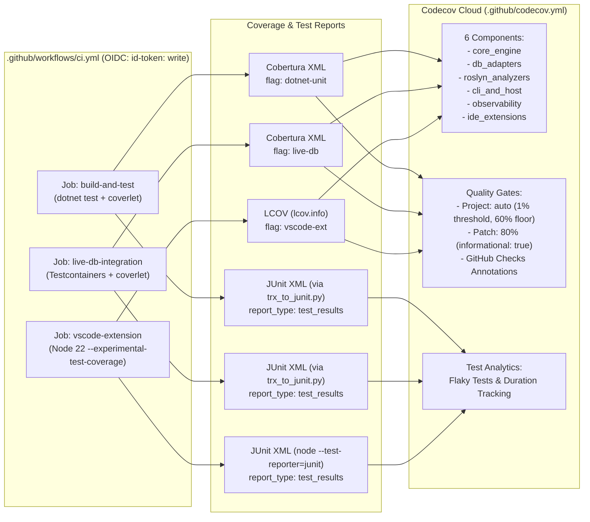

# Brainstorm Report: Codecov Integration (`thanhnt-sm/eco_support_net_oracle`)

## 1. Problem Statement & Requirements
Integrate `thanhnt-sm/eco_support_net_oracle` with Codecov (`https://app.codecov.io/github/thanhnt-sm/eco_support_net_oracle/new`), leveraging all high-value **free open-source Codecov features** while respecting the repository's strict security, license, and workspace governance gates:
- **40-char commit SHA pinning** (`standards-audit.yml`) & **least-privilege job permissions** (OpenSSF Scorecard).
- **Effective fail-fast test steps** (`scripts/check-workflow-policy.py` rule `(f)` forbids `continue-on-error` on `dotnet test`).
- **Workspace root allowlist** (`scripts/anti_garbage_guard.sh` and `scripts/preflight_agent_check.sh`).
- **Bilingual documentation sync** (`README.md` + `README.vi.md` verified by `scripts/verify_docs_sync.sh`).
- **Locked NuGet/npm dependencies** (`RestoreLockedMode=true` / `npm ci`) without unnecessary lockfile or license-gate churn.

## 2. Evaluated Approaches

| Approach | Description | Pros | Cons |
|---|---|---|---|
| **Option A: Minimal .NET Coverage (KISS)** | Upload existing `coverage.cobertura.xml` from `build-and-test`, add basic `.github/codecov.yml` and 1 header badge. | Smallest diff; zero new scripts. | Misses `live-db-integration` adapter coverage, `vscode-extension` TS coverage, Component matrix, and Test Analytics. |
| **Option B: Full Free-Tier Suite (Selected)** | Multi-flag coverage (`dotnet-unit`, `live-db`, `vscode-ext`), `.github/codecov.yml` with 6 Components + Flags + Carryforward + PR Comment + GitHub Annotations, Test Analytics (`report_type: test_results` via Python TRX→JUnit & Node 22 native JUnit/LCOV), and rich README telemetry (Header Badge + Component Matrix + Sunburst/Grid Graphs). | Unlocks 100% of relevant free OSS Codecov features; **zero NuGet/npm lockfile changes**; full compliance with all repo gates. | Requires a small Python helper (`scripts/trx_to_junit.py`) and 3 job updates in `ci.yml`. |
| **Option C: Full Suite + Bundle Analysis** | Option B plus `@codecov/bundle-analyzer` on `src/DataGuard.VSCode`. | Tracks JS asset size. | `DataGuard.VSCode` compiles via `tsc -p ./` (not Vite/Webpack/Rollup), so bundle analysis adds npm dependencies and lockfile churn for minimal value. |

## 3. Final Recommended Solution & Architecture

### 3.1. Configuration File: `.github/codecov.yml`
Placed inside `.github/` to satisfy `anti_garbage_guard.sh` and `preflight_agent_check.sh`:
- **`codecov`**: `require_ci_to_pass: true`, `notify.wait_for_ci: true`.
- **`coverage`**: `precision: 2`, `round: down`, `range: "60...90"`.
  - **`status.project.default`**: `target: auto`, `threshold: 1%` (blocking gate on regressions >1%).
  - **`status.patch.default`**: `target: 80%`, `informational: true` (reports PR diff coverage without blocking small/refactoring PRs initially).
- **`parsers.cobertura`**: `partials_as_hits: false`, `handle_missing_conditions: true`.
- **`github_checks`**: `annotations: true` (inline PR diff annotations on uncovered lines).
- **`comment`**:
  - `layout: "condensed_header, diff, flags, components, files, condensed_footer"`
  - `behavior: default`, `require_changes: false`.
- **`flags`**:
  - `dotnet-unit`: `paths: [src/]`, `carryforward: true`
  - `live-db`: `paths: [src/]`, `carryforward: true`
  - `vscode-ext`: `paths: [src/DataGuard.VSCode/]`, `carryforward: true`
- **`component_management.individual_components`**:
  1. `core_engine` ("Core Engine & Contracts"): `src/DataGuard.Core/**`, `src/DataGuard.Contracts/**`, `src/DataGuard.SqlClassification/**`
  2. `db_adapters` ("Database Adapters"): `src/DataGuard.Oracle.Adapter/**`, `src/DataGuard.SqlServer.Adapter/**`, `src/DataGuard.PostgreSql.Adapter/**`, `src/DataGuard.MySql.Adapter/**`
  3. `roslyn_analyzers` ("Roslyn Analyzers & CodeFixes"): `src/DataGuard.Analyzers/**`, `src/DataGuard.CodeFixes/**`
  4. `cli_and_host` ("CLI, Host, Build & LSP"): `src/DataGuard.Cli/**`, `src/DataGuard.Host/**`, `src/DataGuard.Build/**`, `src/DataGuard.LanguageServer/**`
  5. `observability` ("Enterprise Observability"): `src/DataGuard.Observability/**`, `src/DataGuard.Observability.AspNetCore/**`, `src/DataGuard.Observability.Messaging/**`
  6. `ide_extensions` ("VS Code & Visual Studio Extensions"): `src/DataGuard.VSCode/**`, `src/DataGuard.VisualStudio/**`
- **`ignore`**: `tests/**`, `samples/**`, `scripts/**`, `tools/**`, `docs/**`, `plans/**`, `**/obj/**`, `**/*.g.cs`, `src/DataGuard.VSCode/test/**`, `src/DataGuard.VSCode/out/*.test.js`, `src/DataGuard.VSCode/out/ui/*.test.js`.

### 3.2. CI Workflow Updates (`.github/workflows/ci.yml`)
- **Action Pinning**: `uses: codecov/codecov-action@303a32d7a59b442fa8d48b6a1cc6825c09c847a5 # v7.1.1`
- **Job-Level Permissions**: Add `permissions: { contents: read, id-token: write }` to `build-and-test`, `live-db-integration`, and `vscode-extension`.
- **Execution Guard**: `if: ${{ !cancelled() && env.ACT != 'true' }}` on all Codecov upload steps so local `act` runs skip external uploads and failed test runs still push coverage/test analytics.
- **Zero-Lockfile Test Analytics (`scripts/trx_to_junit.py`)**:
  - Converts VSTest `.trx` files (`**/TestResults/*.trx`) into standard JUnit XML (`**/TestResults/junit.xml`) with unit tests in `scripts/tests/test_trx_to_junit.py`.
  - Uploaded via `codecov/codecov-action` with `report_type: test_results`.
- **VS Code Extension LCOV + JUnit**:
  - In `vscode-extension` job (or `package.json` script `test:coverage`), run Node 22's built-in `--experimental-test-coverage --test-reporter=lcov --test-reporter-destination=coverage/lcov.info --test-reporter=junit --test-reporter-destination=coverage/junit.xml --test-reporter=spec --test-reporter-destination=stdout`.

### 3.3. Bilingual README Enhancements (`README.md` & `README.vi.md`)
1. **Top Badge Bar**:
   - Add `` next to the Build and OpenSSF badges in both `README.md` and `README.vi.md`.
2. **Coverage & Quality Telemetry Section**:
   - Add a concise section in both `README.md` and `README.vi.md` featuring:
     - **Component & Flag Status Table**: Live badges per Flag (`dotnet-unit`, `live-db`, `vscode-ext`) and per Component (`core_engine`, `db_adapters`, `roslyn_analyzers`, `cli_and_host`, `observability`, `ide_extensions`).
     - **Visual Coverage Graphs**: Embeddable Codecov **Sunburst** (`graphs/sunburst.svg`) and **Grid** (`graphs/grid.svg`) visualizations linking to `https://app.codecov.io/gh/thanhnt-sm/eco_support_net_oracle`.

## 4. Implementation Considerations & Risks
- **Risk 1 — First-Run OIDC Activation on Codecov UI**: The repository owner must click **"Configure"** on `https://app.codecov.io/github/thanhnt-sm/eco_support_net_oracle/new` (installing the Codecov GitHub App). We will set `fail_ci_if_error: false` so CI never hard-fails if Codecov has a transient outage or before the GitHub App is activated.
- **Risk 2 — Cobertura Duplicate Path Prefixes**: Coverlet emits `/src/...` paths. Our existing Python gate normalizes `/src/` paths; Codecov automatically maps paths relative to the git repository root when `actions/checkout` is used.
- **Risk 3 — Repo Policy Gates**:
  - `standards-audit.yml` (SHA pinning + top-level `permissions:`)
  - `scripts/check-workflow-policy.py` (effective `dotnet test` step)
  - `scripts/verify_docs_sync.sh` (bilingual sync)
  - `scripts/anti_garbage_guard.sh` & `scripts/preflight_agent_check.sh` (root cleanliness)

## 5. Success Metrics & Validation Criteria
- [ ] `.github/codecov.yml` passes YAML schema validation and includes 3 flags + 6 components + PR comment layout + GitHub annotations.
- [ ] `scripts/trx_to_junit.py` + `scripts/tests/test_trx_to_junit.py` pass `python3 -m unittest discover -s scripts/tests -v`.
- [ ] `.github/workflows/ci.yml` uploads coverage & test results for `dotnet-unit`, `live-db`, and `vscode-ext` using SHA-pinned `codecov/codecov-action@303a32d7a59b442fa8d48b6a1cc6825c09c847a5 # v7.1.1` with `use_oidc: true`.
- [ ] `README.md` and `README.vi.md` display the header badge, Component/Flag telemetry matrix, and Sunburst/Grid graphs.
- [ ] All local gates pass (`scripts/anti_garbage_guard.sh`, `scripts/preflight_agent_check.sh`, `scripts/verify_docs_sync.sh`, `python3 scripts/check-workflow-policy.py`).

## 5.1. TypeSafe System One & `ck:advisor` Verification Summary
- **`xd://typesafe_judge`**:
  - `scope_completeness`: `score = 0.95`
  - `security_compliance`: `noul = 0.59`
  - `recommended_tier`: `choice = "Option B"` (`confidence = 0.97`)
- **`xd://typesafe_advisor` (Bicameral Engine)**:
  - `verdict = "AUTO_APPROVE"`, `ckVerdict = "proceed"`, `confidence = 0.98`, `jev.verdict = "APPROVE"` (`Risk: Moderate 1.8/3`, JEV recommended option: `Option B: Full Free-Tier Suite`).
- **`ck:advisor` Subagent (`CodecovAdvisorReview`)**:
  - Verdict: `proceed` (`9.4 / 10` for Option B vs `6.5 / 10` Option A vs `4.0 / 10` Option C).
  - Required implementation refinements incorporated into `/ck:plan`:
    1. Add `--collect:"XPlat Code Coverage"` to `live-db-integration` (`ci.yml:188`) so Cobertura XML is emitted for `flag: live-db`.
    2. Pass `--enable-source-maps` with `--experimental-test-coverage` in `src/DataGuard.VSCode` and set `working-directory: src/DataGuard.VSCode` on the `vscode-extension` Codecov upload step so `lcov.info` maps cleanly to `src/DataGuard.VSCode/src/**/*.ts`.
    3. Keep `fail_ci_if_error: false` and `use_oidc: true` on all `codecov/codecov-action@303a32d7a59b442fa8d48b6a1cc6825c09c847a5 # v7.1.1` steps with `if: ${{ !cancelled() && env.ACT != 'true' }}` while leaving `dotnet test` steps strictly fail-fast.

## 6. Next Steps
1. Approve brainstorm design.
2. Generate detailed phase-by-phase implementation plan via `/ck:plan`.
3. Record technical journal entry via `/ck:journal`.
